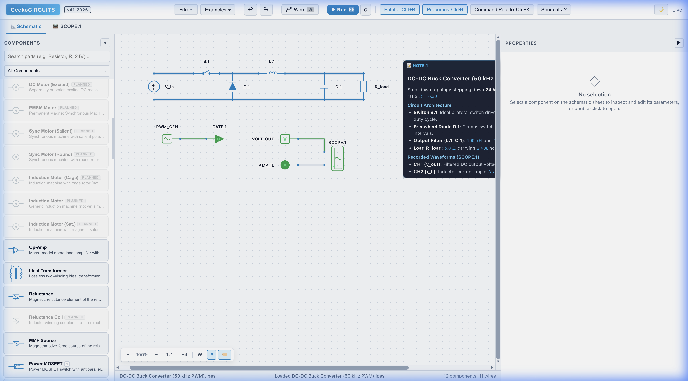
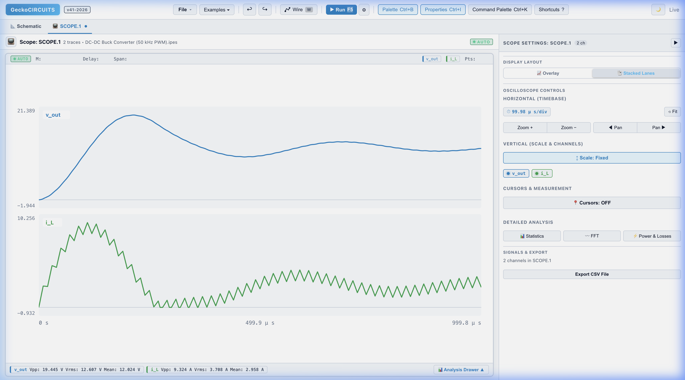

# GeckoCIRCUITS

**Open-source circuit simulator for power electronics** with multi-domain simulation: electrical, thermal, and EMI -- all in one tool.

Originally developed at ETH Zurich's Power Electronic Systems Laboratory by Andreas Muesing, Andrija Stupar, and Uwe Drofenik.

---

## At a Glance

GeckoCIRCUITS is designed specifically for power electronics engineers, researchers, and students. Unlike general-purpose SPICE simulators, it combines specialized piecewise-linear and ideal-switch solvers with rapid numerical convergence, an interactive browser-based circuit canvas, and an integrated multi-channel oscilloscope.

### 1. Interactive Schematic Capture
Design power converter topologies, gate drives, filters, and digital/analog control loops with instant design-rule checking and parameter editing:


*Visual schematic capture: DC-DC Buck converter (50 kHz PWM) featuring power stage (MOSFET switch, freewheeling diode, LC filter, load), PWM gate drive, voltage/current sensors, multi-channel oscilloscope, and schematic documentation note.*

### 2. Integrated Multi-Channel Oscilloscope & Waveform Analysis
Run simulations with one keystroke (`F5` or the toolbar button) and immediately inspect high-frequency switching transients, steady-state ripple, and harmonic spectra without external post-processing tools:


*Oscilloscope view: stacked lane display of regulated DC output voltage ($v_{out}$) and triangular inductor ripple current ($i_L$) with instantaneous peak-to-peak ($V_{pp}$), RMS, and DC mean metrics.*

---

## Key Features

- **Multi-domain simulation** -- electrical + thermal + EMI in a single environment
- **Fast simulation engine** -- optimized for power electronics (MNA-based solvers: Backward Euler, Trapezoidal, Gear-Shichman)
- **Visual circuit editor** -- drag-and-drop schematic capture with built-in multi-channel oscilloscope
- **64+ control blocks** -- PI/PID, integrators, limiters, lookup tables, state machines, and more
- **Firmware-in-the-loop (NativeC)** -- run real C/C++ microcontroller firmware directly in the simulation
- **Thermal analysis** -- junction temperature, loss calculation, heatsink design
- **EMI filter design** -- common-mode/differential-mode filter analysis
- **MATLAB/Simulink integration** -- remote control via RMI or memory-mapped files
- **Scriptable** -- built-in JavaScript (GraalVM) and Java block scripting
- **Model Context Protocol (MCP) Server** -- 13 tools for autonomous AI/LLM circuit synthesis, DRC validation with live script compilation, simulation, and power electronics analytics (Google Antigravity, Claude, Cursor, Copilot)
- **Cross-platform** -- runs on Windows, Linux, and macOS

## Quick Start

### GeckoCIRCUITS Desktop App (recommended)

A native desktop application bundling the React editor, the simulation engine,
and an MCP server for LLM tools — no Java installation required. Installers for
Windows (`.exe`/`.msi`), macOS (`.dmg`), and Linux (`.deb`/`.rpm`/`.AppImage`)
are on the [Releases](https://github.com/MartinRieser/GeckoCIRCUITS/releases) page.
Double-clicking any `.ipes` circuit opens it. See the
[Desktop App guide](docs/desktop-app.md), the
[MCP interface](docs/mcp.md) for LLM integration, and the
[NativeC guide](docs/native-c-blocks.md) for testing real C/C++
microcontroller code in the simulation.

### AI & LLM Integration (MCP Server)

GeckoCIRCUITS provides a native [Model Context Protocol (MCP)](https://modelcontextprotocol.io) server enabling LLMs to autonomously design, validate, simulate, and optimize power electronics circuits without opening a GUI or reading simulator source code:

- **Universal Circuit Authoring (`gecko_create_circuit`)**: Synthesizes complete `.ipes` circuit models from JSON netlists (power topologies, control blocks, MCU scripts, and collision-free layout).
- **Deep Design Rule Validation (`gecko_validate_circuit`)**: Inspects terminal connectivity, floating subnets, and performs **in-memory compilation** of digital microcontroller script blocks (`ScriptBlockCalculator`), providing line-level syntax diagnostics.
- **In-Memory Analytics (`gecko_measure_metrics`)**: Evaluates real-time power electronics figures of merit (efficiency $\eta$, power factor $\text{PF}$, THD, DC average, and peak-to-peak ripple $\Delta V_{pp}$) directly from simulation runs without downloading massive waveform files.
- **Parametric Model Generators**: Instant turnkey generation of active PFC (`gecko_setup_pfc_project`) and resonant LLC converters (`gecko_setup_llc_project`).
- **Autonomous Tuning**: Sweep and optimize PI loops and parameters with `gecko_tune_pfc` and `gecko_patch_component`.

Connect your LLM agent (e.g. Google Antigravity, Claude Desktop, Cursor) using `scripts/desktop/launch-mcp.py` or the bundled desktop launcher. See the [full MCP Guide](docs/mcp.md) for tool documentation, JSON schemas, and client configuration.

### Platform Launcher Scripts

Run from a repository checkout with the launcher in the repository root — it
builds the engine jar if needed, starts it on localhost:8080, and opens the
editor in a standalone app window:

| Platform | Command |
|----------|---------|
| Windows | `run-gecko.bat` |
| Linux / macOS / WSL | `./run-gecko.sh` |

The `scripts/run-gecko*` scripts are convenience bridges that simply forward
to the root launcher.

## Examples

The `resources/` directory contains ready-to-simulate circuits:

| Example | Description | Location |
|---------|-------------|----------|
| Buck Converter | Basic DC-DC step-down | `resources/tutorials/2xx_dcdc_converters/201_buck_converter/` |
| Boost Converter | DC-DC step-up | `resources/tutorials/2xx_dcdc_converters/202_boost_converter/` |
| Three-Phase Inverter | DC-AC conversion | `resources/tutorials/4xx_dcac_inverters/402_three_phase_inverter/` |
| Thermal Simulation | Junction temperature analysis | `resources/tutorials/5xx_thermal_simulation/502_junction_temperature/` |
| PFC Boost | Power factor correction | `resources/tutorials/3xx_acdc_rectifiers/302_pfc_basics/` |
| Vienna Rectifier | Three-phase AC-DC | `resources/tutorials/3xx_acdc_rectifiers/303_vienna_rectifier/` |
| EMI Filters | CM/DM filter design | `resources/tutorials/6xx_emi_emc/602_cm_dm_filters/` |

## Build from Source

```bash
# Clone
git clone https://github.com/MartinRieser/GeckoCIRCUITS.git
cd GeckoCIRCUITS

# Build (simulation core, REST API, and MCP server)
mvn clean package -DskipTests

# Run GeckoCIRCUITS (serves http://localhost:8080/gecko/)
run-gecko.bat    &:: Windows
./run-gecko.sh   # Linux / macOS

# Run tests
mvn test
```

Requires: Java 25 JDK + Maven 3.6+

> If the build fails with `error: release version 25 not supported`, Maven is running on an older JDK.
> Point `JAVA_HOME` at a JDK 25 installation and verify with `mvn -version` (it prints the Java version Maven uses).

## Logging Configuration

GeckoCIRCUITS uses **Apache Log4j2** for structured console and file logging.

### Output Locations
- **Console**: Logs are outputted to stdout.
- **File**: Logs are saved in a rolling file at `logs/gecko.log` (automatically rolled over at 10 MB, up to 10 archives / 100 MB max).

### Configuring Log Levels at Startup
You can configure the log level dynamically using the `gecko.log.level` system property:

| Level | VM Option / Command | Description |
|-------|---------------------|-------------|
| **Disabled** | `-Dgecko.log.level=OFF` | Silences all logging output |
| **Error Only** | `-Dgecko.log.level=ERROR` | Logs only error events |
| **Standard (Default)** | `-Dgecko.log.level=INFO` | Logs standard informational events |
| **Full / Debug** | `-Dgecko.log.level=TRACE` | Logs verbose debug and trace info |

Example running the JAR with error-only logging:
```bash
java -Dgecko.log.level=ERROR -jar backend/gecko-rest-api/target/gecko-rest-api.jar
```

To redirect the logs to a custom directory, set `-Dgecko.log.dir=/path/to/logs`.

## Architecture

```
GeckoCIRCUITS
├── Simulation Engine (MNA matrix, LU decomposition, 3 solver types)
├── Circuit Components (R, L, C, diodes, MOSFETs, IGBTs, transformers, ...)
├── Control Blocks (64+ calculators: PI, PID, integrator, gain, limiter, ...)
├── Thermal Domain (loss models, thermal networks, heatsink simulation)
├── EMI Domain (CISPR filters, CM/DM analysis)
├── Visualization (oscilloscope, FFT, THD, RMS analysis)
└── Integration (RMI for MATLAB, memory-mapped files, JavaScript scripting)
```

## Documentation

Full interactive documentation is deployed at **[martinrieser.github.io/GeckoCIRCUITS](https://martinrieser.github.io/GeckoCIRCUITS/)** and available directly in the repository [`docs/`](docs/) directory:

| Topic | Online Documentation | Repository Source | Description |
| :--- | :--- | :--- | :--- |
| **Desktop App** | [Desktop Guide](https://martinrieser.github.io/GeckoCIRCUITS/desktop-app/) | [docs/desktop-app.md](docs/desktop-app.md) | Native desktop shell, installation, and architecture |
| **Getting Started** | [Getting Started](https://martinrieser.github.io/GeckoCIRCUITS/getting-started/) | [docs/getting-started/index.md](docs/getting-started/index.md) | First simulation, schematic editor, and quickstart |
| **AI & LLM Tools (MCP)** | [MCP Guide](https://martinrieser.github.io/GeckoCIRCUITS/mcp/) | [docs/mcp.md](docs/mcp.md) | Model Context Protocol tools for AI circuit synthesis & DRC |
| **Firmware in the Loop** | [NativeC Guide](https://martinrieser.github.io/GeckoCIRCUITS/native-c-blocks/) | [docs/native-c-blocks.md](docs/native-c-blocks.md) | Run real C/C++ microcontroller firmware in simulation |
| **Tutorials** | [Tutorials](https://martinrieser.github.io/GeckoCIRCUITS/tutorials/) | [docs/tutorials/index.md](docs/tutorials/index.md) | DC-DC, AC-DC rectifiers, DC-AC inverters, thermal & magnetics |
| **Examples Library** | [Examples](https://martinrieser.github.io/GeckoCIRCUITS/examples/) | [docs/examples/index.md](docs/examples/index.md) | 125+ ready-to-simulate power electronics circuit models |
| **API Reference** | [API Reference](https://martinrieser.github.io/GeckoCIRCUITS/api/) | [docs/api/index.md](docs/api/index.md) | REST API, WebSocket waveform streaming, and GeckoSCRIPT |
| **Developer Guide** | [Developer Guide](https://martinrieser.github.io/GeckoCIRCUITS/resources/developer-guide/) | [docs/resources/developer-guide.md](docs/resources/developer-guide.md) | Architecture, local builds, and development guidelines |

## Contributing

Contributions are welcome! See [CONTRIBUTING.md](CONTRIBUTING.md) for the full guide.

```bash
# Run backend engine, REST API & MCP server tests
mvn test

# Run frontend React & canvas tests
npm --prefix frontend test

# Run frontend linting
npm --prefix frontend run lint
```

## License

This project is dual-licensed:

- **Open Source**: [GNU General Public License v3.0](LICENSE) -- free for academic, research, and open-source use
- **Commercial**: Contact for commercial licensing terms

Copyright (c) ETH Zurich, Power Electronic Systems Laboratory. Originally developed by Andreas Muesing, Andrija Stupar, and Uwe Drofenik.

## Links

- **Documentation**: [https://martinrieser.github.io/GeckoCIRCUITS/](https://martinrieser.github.io/GeckoCIRCUITS/)
- **GitHub Releases**: [Latest Release (v42-2026)](https://github.com/MartinRieser/GeckoCIRCUITS/releases/latest)
- **Original SourceForge Project**: [sourceforge.net/projects/geckocircuits](https://sourceforge.net/projects/geckocircuits/)
