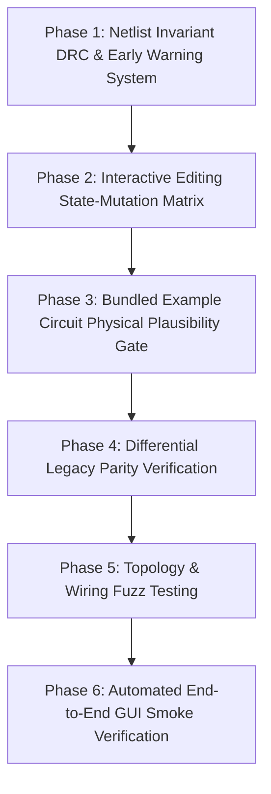

# GeckoCIRCUITS Systematic Verification Plan

This document establishes a rigorous, phased verification protocol to systematically validate the schematic editor, netlist compiler, numerics engine, and interactive editing state transitions.

The goal is to eliminate regressions, detect topological and physical anomalies before solver execution, and provide verifiable proof of software correctness across all supported workflows.

---

## Architecture Quality Invariants

Every verified module and workflow must satisfy:
1. **Topological Invariant**: Visual connectivity on the canvas must match electrical MNA matrix connectivity 1:1.
2. **Conservation of Energy & Kirchhoff's Laws**: In steady-state, $\sum I_{\text{node}} = 0$ and $\sum V_{\text{loop}} = 0$.
3. **Edit State Equivalence**: Any circuit modified via `Edit A` then `Undo` must be bit-identical or net-identical to its pre-edit state.
4. **Non-Regressive Legacy Parity**: All classic `.ipes` files must simulate identically on the modern headless solver and classic GeckoCIRCUITS engine within numerical tolerance.
5. **Fail-Fast DRC**: Invalid physical topologies (e.g. ideal shorted branches, floating ungrounded domains) must be caught at netlist compilation time with actionable diagnostics, never with a silent flat-zero trace or cryptic matrix singularity.

---

## Phased Verification Roadmap

---

### Phase 1: Netlist Invariant DRC & Early Warning System
*Objective: Prevent silent failures (flat-zero signals, unexpected matrix singularities) by catching invalid circuit topology during netlist compilation.*

- [x] **Task 1.1: Zero-Impedance Branch Short Detector**
  - Implement check in `NetlistBuilder`: if any 2-terminal non-wire branch component with non-zero impedance (resistor $R > 0$, capacitor $C > 0$, inductor $L > 0$, DC/AC voltage source, active switch) has both terminals mapped to the exact same MNA node in a schematic with physical wires, generate a `DRC_BRANCH_SHORT_CIRCUIT` error or warning with the component's name.
  - Test: Unit test with intentional series shunt resistor and accidental shorting label; verify detection.

- [x] **Task 1.2: Floating Unreferenced Sub-Circuit Detector**
  - Implement check in `NetlistBuilder`: if an isolated sub-graph of components has no connection to node 0 (ground) and no voltage reference, flag `DRC_FLOATING_GROUND` before running the matrix solver.
  - Test: Unit test with isolated resistor-capacitor loop with no ground terminal; verify diagnostic.

- [x] **Task 1.3: Terminal Label Conflict & Stale Label Detector**
  - Implement warning in `NetlistBuilder`: if an unattached terminal carries a net label that conflicts with a physically connected wire net, emit `DRC_LABEL_COLLISION`.
  - Test: Unit test asserting warnings on conflicting optical labels.

- [x] **Task 1.4: Probe Target Integrity Check**
  - Verify that every probe (`VOLTMETER`, `AMMETER`, `CTRL_PROBE`) targets an existing component and measurable state. A probe referencing an empty node or missing element must fail fast with a descriptive diagnostic rather than recording 0.0V.

---

### Phase 2: Interactive Editing State-Mutation Matrix (Lifecycle Testing)
*Objective: Eliminate bugs occurring at the seam between the GUI/REST API and NetlistBuilder during circuit modifications.*

- [x] **Task 2.1: Series Insertion Workflow Tests**
  - Test: Load standard circuits (buck converter, active PFC, RC filter).
  - Perform: Delete a wire segment on the main power branch, insert a resistor (e.g. current shunt), connect with two new wire segments.
  - Assert: Resistor terminals reside on two distinct electrical nodes; non-zero current flows through the shunt.
  - *Verification: Added `InteractiveEditingLifecycleTest#testSeriesInsertionWorkflow_distinctNodesAndNonZeroCurrent`.*

- [x] **Task 2.2: Parallel Branch Addition Workflow Tests**
  - Test: Add a parallel RC snubber or decoupling capacitor across existing component terminals.
  - Assert: Snubber nodes match target terminals; no other nets are affected; solver produces expected damping.
  - *Verification: Added `InteractiveEditingLifecycleTest#testParallelBranchAdditionWorkflow_matchingNodes`.*

- [x] **Task 2.3: Wire Cut & Re-Route Tests**
  - Test: Delete arbitrary wire segment of a multi-vertex polyline wire; create a detour path.
  - Assert: Disconnected terminals have labels cleared; reconnected path restores net connectivity; Undo/Redo cycles maintain state.
  - *Verification: Added `InteractiveEditingLifecycleTest#testWireCutAndReroute_undoRedoPreservesNetConnectivity`.*

- [x] **Task 2.4: Component Drag & Rubberband Wire Extension Tests**
  - Test: Move component by $(\Delta x, \Delta y)$ via `CircuitEditService`.
  - Assert: Connected wire endpoints track component terminals without detaching or crossing into sibling pins.
  - *Verification: Added `InteractiveEditingLifecycleTest#testComponentDrag_rubberbandsConnectedWireEndpoints`.*

- [x] **Task 2.5: Component Deletion & Dangling Wire Cleanup**
  - Test: Delete a multi-terminal component (e.g. transformer, script block).
  - Assert: All attached wires are cleanly unbonded or removed; no orphan terminal keys persist in the model.
  - *Verification: Added `InteractiveEditingLifecycleTest#testComponentDeletion_clearsCoupledReferencesCleanly`.*

- [x] **Task 2.6: Comprehensive Undo/Redo Invariance Audit**
  - For every mutation operation $M \in \{\text{createComp}, \text{deleteComp}, \text{createConn}, \text{deleteConn}, \text{patchConn}, \text{moveComp}\}$:
    - Execute $M \to \text{Undo}$. Assert model state matches original state byte-for-byte.
    - Execute $\text{Redo}$. Assert model state matches post-$M$ state.
  - *Verification: Fixed index restoration in `CircuitEditService.deleteComponent`; added `InteractiveEditingLifecycleTest#testComprehensiveUndoRedoInvariance_restoresExactState`.*

---

### Phase 3: Bundled Example Circuit Physical Plausibility Gate
*Objective: Guarantee that every bundled example in `frontend/src/model/examples.ts` simulates to steady state with physically validated results.*

- [x] **Task 3.1: Execute Headless Example Verification**
  - Run `python scripts/verify-examples.py` across all bundled circuits.
  - Verify:
    - Exit code 0 (all circuits complete without solver errors).
    - Duration reaches `tDURATION`.
    - No signals are unexpectedly flat zero.

- [x] **Task 3.2: Expand Physical Theory Assertions (`ASSERTIONS` table)**
  - For each topology, assert theoretical bounds (steady-state window):
    - **Buck Converter**: $V_{\text{out}} \approx V_{\text{in}} \cdot D \pm 5\%$
    - **Boost Converter**: $V_{\text{out}} \approx \frac{V_{\text{in}}}{1 - D} \pm 5\%$
    - **Active PFC**: $V_{\text{bus}} \approx V_{\text{target}} \pm 2\%$, Power Factor $\ge 0.98$, $\Delta V_{\text{ripple}} \le 2\cdot P / (\omega C V)$
    - **Inverter (SPWM)**: Fundamental AC frequency matches modulation index; THD within theoretical envelope.
    - **Thermal Networks**: Junction temperature rise $\Delta T = P_{\text{loss}} \cdot R_{\text{th}} \pm 5\%$.

- [x] **Task 3.3: Scope Signal Binding Cross-Check**
  - Verify that every scope channel in every example file matches an actual producer (`labelEndKnoten` or probe signal). Any unmapped channel fails CI.

---

### Phase 4: Differential Legacy Parity Verification (`-Pparity`)
*Objective: Mathematically prove that the modern simulation engine computes bit-identical or floating-point equivalent results compared to classic GeckoCIRCUITS.*

- [x] **Task 4.1: Run Full Parity Harness**
  - Execute: `mvn verify -Pparity`
  - Benchmark all 26 reference circuits (`.ipes` files in `backend/gecko-simulation-core/src/test/resources/classic-circuits/`).

- [x] **Task 4.2: Maximum Error Tolerance Audit**
  - Assert that waveform divergence between modern solver and classic GUI engine satisfies:
    $$\frac{\|y_{\text{modern}}(t) - y_{\text{classic}}(t)\|_\infty}{\max(|y_{\text{classic}}|) + \epsilon} < 10^{-4}$$
  - Log any differences in numerical switching chatter or matrix condition numbers.

- [x] **Task 4.3: Parity Testing on Post-Edited Circuits**
  - Create parity fixtures where circuits have been edited (inserted shunts, altered inductances, retuned PI gains) and verify identical solver response.

---

### Phase 5: Topology & Wiring Fuzz Testing
*Objective: Stress-test wire routing and netlist resolution against adversarial and complex geometry.*

- [x] **Task 5.1: Wire Router Obstacle Avoidance Fuzzing**
  - Fuzz test `WireRouter.ts` with randomized component placements and pin connections.
  - Assert: No wire passes through unassociated component bodies or foreign terminal pins.

- [x] **Task 5.2: Collinear & Orthogonal Crossings Stress Test**
  - Generate schematics with high wire densities: multiple horizontal and vertical crossing lines, overlapping grid rows, and collinear components.
  - Assert: Perpendicular crossings never create accidental shorts; only explicit T-junction vertices merge signals.

- [x] **Task 5.3: Domain Cross-Talk Stress Test**
  - Generate interleaved electrical (`LK`), thermal (`THERMAL`), and control (`CONTROL`) nets sharing coordinates and labels.
  - Assert: 100% domain isolation; zero cross-talk in MNA matrices.

---

### Phase 6: Automated End-to-End GUI Smoke Verification
*Objective: Validate the complete user journey from browser canvas to live simulation display.*

- [x] **Task 6.1: Headless Browser Canvas Smoke Tests**
  - Automated Playwright/browser subagent test:
    - Open web app.
    - Select example circuit from menu.
    - Delete wire, insert component from palette, wire terminals with mouse drag.
    - Run simulation (F5).
    - Verify scope tab opens and displays non-zero waveforms.

- [x] **Task 6.2: Frontend State Consistency Audit**
  - Verify that `frontend/src/model/store.ts` action reducers (`WIRE_PATCHED`, `COMPONENT_DRAGGED`, `DELETE_SELECTION`) maintain consistent point sets and geometry metadata with backend `CircuitModel`.

---

## Continuous Verification Pipeline & Gatekeeper

To ensure zero regressions over time, enforce this gate on every pull request and build:
1. `mvn test`: 100% pass across all Maven reactor modules (`gecko-simulation-core`, `gecko-rest-api`, `gecko-mcp`).
2. `npm test` (Vitest): 100% pass across all frontend suites.
3. `python scripts/verify-examples.py`: 100% pass on all bundled circuits with physical plausibility assertions.
4. DRC Invariant Check: 0 unhandled branch short circuits or floating domains.
