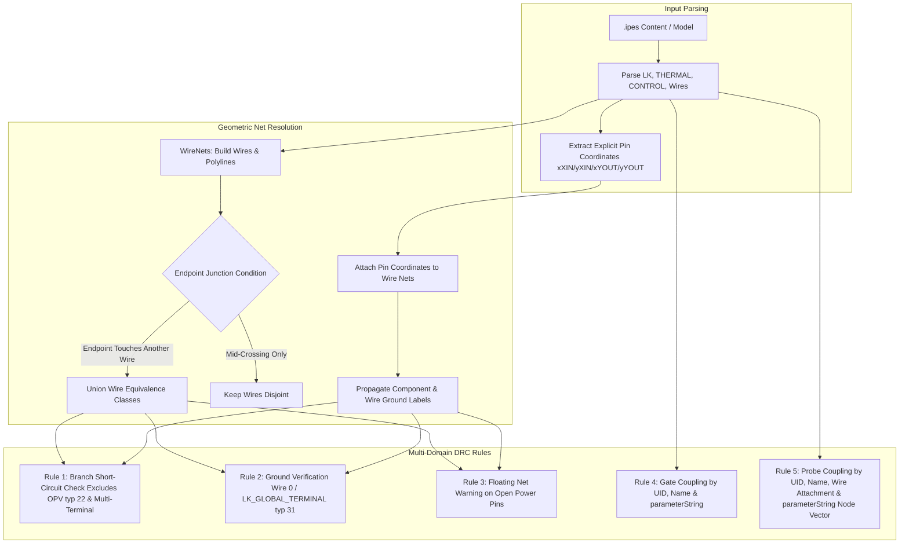
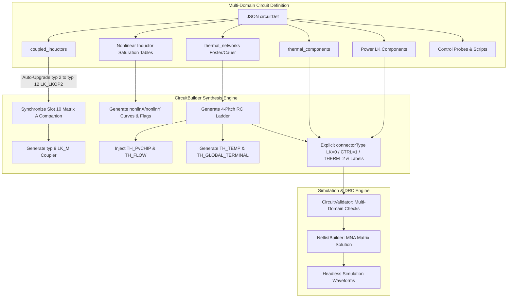

# Comprehensive Architectural Plan: .ipes Standardization, Wire-Based DRC & Platform Improvements

## Executive Summary

Based on the completion and validation of all 21 converter and multi-domain tutorials, this plan addresses the core technical bottlenecks identified during testing:
1. **The `.ipes` Topic (Highest Priority - COMPLETED in Phase 1)**: Standardized all project files to plain UTF-8 text (eliminating binary GZIP confusion in git and Python tools), with zero backward compatibility baggage while guaranteeing 100% of repository project files continue to validate and simulate.
2. **Wire-Based Ground & Net Mapping in DRC (Phase 2 - COMPLETED)**: Reworked `CircuitValidator` to geometric coordinate netlist resolution aligned with simulation engine semantics (`NetlistBuilder`), eliminating false short-circuits from wire crossings, handling wire-labeled grounds, and supporting name-based gate coupling and probe measurement node resolution.
3. **Sequential Platform Improvements (Phases 3–7)**: Multi-domain synthesis schema, specialized thermal/magnetic metrics, pre-flight topological validation, parameterized control libraries, and developer ergonomics (Python SDK, SVG exporter).

---

## Status Dashboard

| Phase | Description | Status | Commit / Milestone |
| :--- | :--- | :--- | :--- |
| **Phase 1** | Plain Text `.ipes` Normalization & Default Writers | **DONE** | `b1da6bc7` (229 files normalized, default `compress=false`) |
| **Phase 2** | Wire-Based Ground & Net Mapping in DRC | **DONE** | `4620f5c` (58/58 tests green, 0 false short circuits, 0 dangling gates/probes) |
| **Phase 3** | Multi-Domain Synthesis in `gecko_create_circuit` | **DONE** | `674517b` (Coupled inductors, Foster/Cauer RC chains, non-linear saturating inductors, 61/61 tests green) |
| **Phase 4** | Domain-Specific Metrics in `gecko_measure_metrics` | **DONE** | `5e892987` (Thermal, magnetic Steinmetz/saturation, mechanical speed/torque metrics, 66/66 tests green) |
| **Phase 5** | Pre-Flight Topology Checks (Singular Matrix Prevention) | Planned | Pre-solver diagnostics |
| **Phase 6** | Parameterized Control Block Library | Planned | Standardized SPWM, PI, Deadtime blocks |
| **Phase 7** | Developer Ergonomics: Python SDK & SVG Export | Planned | `geckopy` & `gecko_export_schematic_svg` |

---

## Phase 1: The `.ipes` Standardization (COMPLETED)

### Deliverables Completed
- **Normalization Script**: Executed `scripts/desktop/normalize_ipes.py`, converting all 229 binary GZIP `.ipes` files to plain UTF-8 text with clean LF/CRLF line endings across `resources/`, `docs/`, and `backend/`.
- **Core Writers Updated**:
  - `CircuitBuilder.java`: changed default to `compress = false`.
  - `CircuitFileWriter.java`: changed default `write(model)` to plain text UTF-8.
  - `IpesSupport.java`: maintained transparent decompression for external files, defaulted writing to uncompressed.
- **Verification Gates Passed**:
  - `python scripts/verify-examples.py`: 14/14 baseline examples simulate successfully.
  - `python scripts/desktop/build_tutorials.py`: all 21 tutorials pass validation and headless execution.
  - `mvn test`: 100% green across `gecko-simulation-core` and `gecko-mcp`.

---

## Phase 2: Wire-Based Ground and Net Mapping in DRC (COMPLETED)

### Final Repository-Wide Diagnostic Results (All 151 `.ipes` Files)

| Diagnostic Rule | Pre-Phase 2 Baseline | Phase 2 v1 (Flawed) | Phase 2 Final (Verified) | Outcome & Resolution |
| :--- | :---: | :---: | :---: | :--- |
| `SHORT_CIRCUIT` errors | 1 | 73 | **1** | **Resolved**: 72 false short circuits eliminated. Only the intentional 0-Ohm shunt in `A_Buck.ipes` remains. Mid-crossings no longer merge wires; explicit `xXIN[]`/`yXIN[]`/`xYOUT[]`/`yYOUT[]` coordinates are respected; op-amp negative feedback (`typ 22`) is properly excluded. |
| `DANGLING_GATE` errors | 104 | 104 | **0** | **100% Resolved**: Name-based switch coupling (`parameterString[]` containing `/SwitchName/...`) and negative UIDs are properly handled. |
| `DANGLING_PROBE` errors | 37 | 37 | **0** | **100% Resolved**: Probes with node-label vectors in `parameterString[]` (e.g. `/in1/u_load/0`), component names, and wire geometry connections resolve cleanly. |
| `MISSING_GROUND` errors | 46 | 48 | **47** | **Accurate**: Wire-based ground labels (`"0"`, `"gnd"`) and `LK_GLOBAL_TERMINAL` (typ 31) are recognized. The remaining 47 correspond genuinely to ungrounded legacy subcircuits. |
| `UNBALANCED_BRACES` | 0 | 0 | **0** | Clean control script syntax across all files. |

### Technical Architecture Implemented



### Key Technical Solutions
1. **Exact Endpoint-Junction Connectivity**:
   - Wires merge in `DisjointSet<Integer>` if and only if an endpoint (`endA` or `endB`) touches another wire. Mid-crossings without an endpoint junction remain strictly separate nets.
   - Removed segment rasterization to prevent phantom hops across non-adjacent components.
2. **Explicit Pin Coordinate Extraction**:
   - Parses `xXIN[]`, `yXIN[]`, `xYOUT[]`, `yYOUT[]` when present in legacy blocks, preventing orientation inversion between input and output ports.
3. **Op-Amp & Multi-Terminal IC Treatment**:
   - Excluded `LK_OPV1` (`typ 22`) from two-terminal branch short-circuit checks, allowing negative-feedback configurations (output wired to inverting input) without false DRC errors.
4. **Name-Based Gate & Probe Coupling**:
   - Preserves negative UIDs (`uniqueObjectIdentifier < 0`).
   - If `coupledReferenceID == 0`, resolves target switch from `parameterString[]` (e.g. `/S1/0/0`) via `lkComponentsByName`.
   - Probes check UID, component name, measurement node vectors in `parameterString[]`, and physical terminal coordinates.

### Verification Matrix
- [x] `mvn test -pl backend/gecko-mcp`: 58/58 unit tests passing (0 failures, 0 errors).
- [x] `mvn test -pl backend/gecko-simulation-core`: 100% green.
- [x] `python scripts/desktop/build_tutorials.py`: All 21 tutorials validate with 0 errors and simulate to `COMPLETED`.
- [x] `python scripts/verify-examples.py`: 14/14 physics assertion checks pass.
- [x] Shaded JAR `desktop/app/engine/gecko-mcp.jar` updated.

---

## Phase 3: Multi-Domain Synthesis in `gecko_create_circuit` (COMPLETED)

### Objective
Allow declarative generation of multi-domain circuits (thermal networks, coupled magnetics, non-linear inductors) through the JSON MCP interface with full DRC validation, MNA matrix fidelity, and simulation execution.

### Technical Architecture Implemented



### Key Technical Deliverables
1. **Component Registration in `ComponentCatalog`**:
   - `COUPLED_INDUCTOR` (`LK_LKOP2`, typ 12) with nominal inductance and companion slot 10 mapping.
   - `MUTUAL_INDUCTANCE` (`LK_M`, typ 9) with coupling coefficient $k \in (0, 1]$.
   - `NONLINEAR_INDUCTOR` (`typ 2`) with current/inductance characteristic curves.
   - Thermal domain catalog: `TH_RTH` (46), `TH_CTH` (47), `TH_FLOW` (44), `TH_TEMP` (45), `TH_AMBIENT` (48), `TH_PvCHIP` (41), `TH_GLOBAL_TERMINAL` (50), and human-friendly aliases (`THERMAL_RESISTOR`, `THERMAL_CAPACITOR`, `HEAT_FLOW_SOURCE`, `AMBIENT_TEMPERATURE`, `THERMAL_POWER_LOSS`, `PV_CHIP`, `THERMAL_GROUND`).
2. **Coupled Inductor Synthesis (`CircuitBuilder`)**:
   - Accepts declarative `coupled_inductors: [ { name, inductor1, inductor2, k } ]` or `MUTUAL_INDUCTANCE` components.
   - Automatically upgrades referenced inductors from generic `INDUCTOR` (`typ 2`) to `COUPLED_INDUCTOR` (`typ 12`), initializing slot 10 (`INDEX_EFFECTIVE_L = slot[0]`) to satisfy MNA matrix requirements.
   - Generates `LK_M` (`typ 9`) coupler linking the pair by both UIDs in `rawParameters[1..2]` and names in `parameterStrings[0..1]`.
3. **Electro-Thermal Network Synthesis (`CircuitBuilder`)**:
   - `thermal_networks` declarative synthesis:
     - Supports `model_type: "foster"` (parallel $R_{th} \parallel C_{th}$ ladder stages) and `"cauer"` (series $R_{th}$ with shunt $C_{th}$ to ambient).
     - Standardized 4-grid-unit vertical pitch geometry ensuring exact pin coincident alignment across stages.
     - Couples semiconductor loss via `TH_PvCHIP` (`typ 41`) referencing `target_switch` by name and UID, and/or injects heat flow via `TH_FLOW` (`typ 44`).
     - Binds ambient boundary temperature via `TH_TEMP` (`typ 45`) referenced to thermal ground `TH_GLOBAL_TERMINAL` (`typ 50`).
4. **Non-Linear Saturating Inductor Modeling**:
   - Discretizes $i(L)$ curves from `saturation_table` or `saturation_currents`/`saturation_inductances` vectors into `nonlinX[]` and `nonlinY[]` extra lines with `isNonLinear true`.
5. **DRC & Wire Connector Integration (`CircuitValidator`)**:
   - Explicit `connectorType` stamped on all connections (`0` = LK, `1` = CONTROL, `2` = THERMAL).
   - Handled single-pin geometry for `TH_GLOBAL_TERMINAL` (`typ 50`) and `TH_PvCHIP` (`typ 41`), binding thermal ground `0` without false dangling pin diagnostics.
   - Correctly handles zero-terminal couplers (`LK_M`, `typ 9`) without false short-circuit or floating-terminal warnings.
   - Voltmeter probes support node-pair measurements (`nodeA`, `nodeB`) as well as component branch voltage coupling.

### Verification Matrix
- [x] `CircuitBuilderTest.buildsAndSimulatesCoupledInductors`: verifies mutual coupling synthesis, DRC validity, and induced secondary AC voltage ($> 20\text{ V}$).
- [x] `CircuitBuilderTest.buildsAndSimulatesElectroThermalCircuit`: verifies Foster RC network synthesis, DRC validity, and junction temperature rise ($T_j > 25^\circ\text{C}$).
- [x] `CircuitBuilderTest.buildsAndSimulatesNonlinearSaturatingInductor`: verifies saturation table serialization, DRC validity, and stable transient simulation.
- [x] Full `mvn test -pl backend/gecko-mcp`: 61/61 unit tests pass (100% green).
- [x] Full `mvn test -pl backend/gecko-simulation-core`: 2,228/2,228 tests pass (100% green).
- [x] `python scripts/desktop/build_tutorials.py`: all 21 converter and multi-domain tutorials validate and simulate cleanly.
- [x] `python scripts/verify-examples.py`: all 14 baseline examples pass physics assertions.
- [x] Shaded JAR `desktop/app/engine/gecko-mcp.jar` rebuilt and updated.

---

## Phase 4: Domain-Specific Metrics in `gecko_measure_metrics` (COMPLETED)

### Objective
Extend automated post-simulation waveform metrics to cover thermal, magnetic, and mechanical variables without streaming raw time-series over stdio.

### Implementation Summary
1. **Multi-Domain Analytics Engine (`PowerMetricsCalculator`)**:
   - **Thermal Metrics**:
     - Steady-state junction temperature: $T_{j,ss} = \overline{T_j(t)}$
     - Peak thermal ripple: $\Delta T_j = T_{j,max} - T_{j,min}$
     - Temperature rise above ambient: $\Delta T = T_{j,ss} - T_{ambient}$
     - 2% tolerance band settling time ($t_{settle}$) computed across the full transient profile.
     - Equivalent 1st-order thermal time constant $\tau_{th}$ computed from $63.2\%$ rise time.
   - **Magnetic Metrics**:
     - Peak flux $\hat{\Phi}$ and core flux excursion $\Delta \Phi = \Phi_{max} - \Phi_{min}$.
     - Peak flux density $\hat{B} = \hat{\Phi} / A_e$ and flux density excursion $\Delta B = \Delta \Phi / A_e$.
     - Steinmetz core loss density: $P_{vol} = k \cdot f^\alpha \cdot \hat{B}^\beta$ ($\text{W/m}^3$).
     - Total core loss: $P_{total} = P_{vol} \cdot V_e$ ($\text{W}$).
     - Peak inductor current $\hat{I}$, RMS current, peak-to-peak ripple $\Delta I$, ripple percentage $\%$.
     - Core saturation safety margin: $\text{Margin}_{sat} = 1 - \hat{I} / I_{sat}$.
     - Peak stored inductive energy: $E_{mag} = \frac{1}{2} L \hat{I}^2$.
   - **Mechanical Metrics**:
     - Rotor angular velocity mean speed $\bar{\omega}$ (rad/s) and conversion to RPM.
     - Speed ripple (pk-pk and percentage).
     - Reference speed tracking error percentage against `target_speed`.
     - Settling time to within 2% band of `target_speed`.
     - Mechanical torque mean $\bar{T}$, peak torque, torque ripple (pk-pk and percentage).
     - Average shaft mechanical power: $P_{mech} = \overline{\omega(t) \cdot T(t)}$.
   - **Electrical Power Metrics**: 100% backward compatibility preserved for $P_{in}$, $P_{out}$, $S_{in}$, power factor, and conversion efficiency.
   - **Auto-Detection**: Automatic heuristic detection of thermal (`tj`, `temp`, `junction`), magnetic (`phi`, `flux`, `i_l`), and mechanical (`omega`, `speed`, `rpm`, `torque`) probes if explicit signal lists are omitted.
2. **Schema & Tool Registration (`GeckoTools`)**:
   - Exposed all multi-domain parameters (`thermal_signals`, `ambient_temperature`, `flux_signals`, `i_inductor_signals`, `core_area_m2`, `core_volume_m3`, `i_sat`, `inductance`, `steinmetz_k`, `steinmetz_alpha`, `steinmetz_beta`, `frequency`, `speed_signals`, `torque_signals`, `target_speed`).
   - Wired `measureMetrics()` directly to `PowerMetricsCalculator.calculate(csv, args)`.

### Verification Matrix
- [x] `PowerMetricsCalculatorTest.calculatesThermalMetricsWithSettlingAndTimeConstant`: validates steady-state temp, delta T, ripple, 2% settling, and $\tau_{th}$ calculation.
- [x] `PowerMetricsCalculatorTest.calculatesMagneticMetricsWithSteinmetzAndSaturation`: validates peak flux, excursion, flux density, Steinmetz loss density & total loss, current peak/RMS, saturation margin, and stored energy.
- [x] `PowerMetricsCalculatorTest.calculatesMechanicalMetricsWithSpeedSettlingAndTorque`: validates rotor speed, RPM, speed ripple, target settling, tracking error, torque mean/ripple, and shaft mechanical power.
- [x] `PowerMetricsCalculatorTest.autoDetectsDomainsWhenSignalsNotExplicitlyProvided`: validates automatic classification of multi-domain signal names.
- [x] `ToolsTest.measureMetricsEndToEndOnFixture`: validates end-to-end tool execution on circuit fixture.
- [x] Full `mvn test -pl backend/gecko-mcp`: 66/66 unit tests pass (100% green).
- [x] Full `python scripts/desktop/build_tutorials.py`: all 21 tutorials pass DRC and simulate cleanly.
- [x] Full `python scripts/verify-examples.py`: all 14 baseline examples pass physics assertions.
- [x] Shaded JAR `desktop/app/engine/gecko-mcp.jar` rebuilt and updated.

---

## Phase 5: Pre-Flight Topology Checks (Singular Matrix Prevention)

### Objective
Catch topological degeneracies before the MNA solver executes, providing structured actionable diagnostics with `suggested_fix`.

### Rule Checks
1. **Voltage Source Loops**: Direct loop of ideal voltage sources with zero branch resistance.
2. **Inductive Cutsets**: All-inductor cutset carrying discontinuous current steps.
3. **Floating Switches / Unconnected Gates**: Active semiconductor switches with no gating signal connected.
4. **Structured Diagnostics**: Provide JSON diagnostic payload with `suggested_fix` (e.g. "Add series damping resistor of 10 mΩ to voltage source loop").

---

## Phase 6: Parameterized Control Block Library

### Objective
Provide built-in, pre-verified control blocks in `gecko_create_circuit` to avoid repetitive manual scripting.

### Blocks
1. `SPWM_GENERATOR`: Triangular carrier comparison with sinusoidal reference ($m_a, f_{carrier}, f_{grid}$).
2. `PI_CONTROLLER`: Proportional-integral controller with anti-windup clamping and reset input.
3. `DEADTIME_GENERATOR`: Complementary high-side/low-side pulses with configurable blanking delay $t_d$.

---

## Phase 7: Developer Ergonomics: Python SDK & SVG Export

### Objective
Streamline external integration, continuous test workflows, and visual circuit documentation.

### Deliverables
1. **`geckopy` Python SDK**:
   ```python
   from geckopy import Circuit

   ckt = Circuit.open("docs/tutorials/dcdc/buck-converter.ipes")
   ckt.set_parameter("L1", "inductance", 150e-6)
   result = ckt.simulate(duration=0.01)
   print(result.metrics.v_out_mean, result.metrics.efficiency)
   ```
2. **`gecko_export_schematic_svg`**:
   - Render circuit schematic directly to clean SVG/PNG for markdown artifacts and browser inspection.
3. **MCP Server Graceful Reload**:
   - Add reload endpoint to drop file locks during rapid local JAR recompilation.
