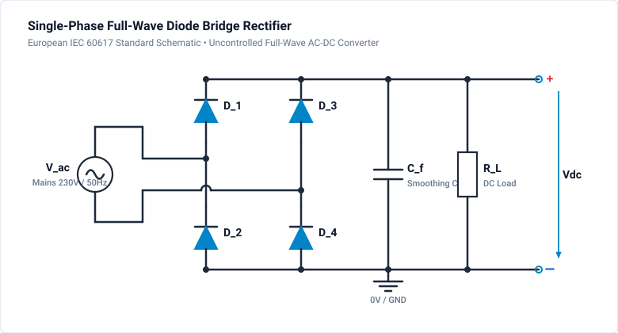
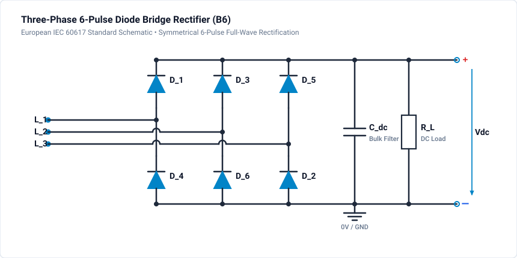

# 301 - Diode Rectifier

Single-phase and three-phase diode bridge rectifiers for AC-DC conversion.

## Overview

Diode rectifiers are the simplest form of AC-DC power conversion, using uncontrolled diodes to convert AC voltage to pulsating DC.

## Topics Covered

- Single-phase half-wave rectifier
- Single-phase full-wave bridge
- Three-phase diode bridge
- Ripple calculation and filtering
- Power factor considerations

## Single-Phase Full-Wave Bridge

### Circuit Configuration

### Key Equations

**Average DC Voltage:**

$$
V_{DC} = \frac{2V_m}{\pi} \approx 0.637 \cdot V_m
$$

**RMS Voltage:**

$$
V_{rms} = \frac{V_m}{\sqrt{2}}
$$

**Ripple Factor:**

$$
\gamma = \sqrt{\left(\frac{V_{rms}}{V_{DC}}\right)^2 - 1} \approx 0.483
$$

## Three-Phase Diode Bridge

### Circuit Configuration

### Key Equations

**Average DC Voltage:**

$$
V_{DC} = \frac{3\sqrt{2}}{\pi} V_{LL} \approx 1.35 \cdot V_{LL}
$$

**Ripple Frequency:** $6 \times \text{line frequency}$ (300 Hz for 50 Hz input)

## Simulation & Project Files

Pre-built and validated simulation project files are included directly in this tutorial directory:

- **Single-Phase Model**: [:material-download: single-phase-rectifier.ipes](single-phase-rectifier.ipes)
- **Three-Phase Model**: [:material-download: three-phase-rectifier.ipes](three-phase-rectifier.ipes)

### Simulation Settings

| Setting | Single-Phase Model | Three-Phase Model |
| :--- | :--- | :--- |
| **Project File** | `single-phase-rectifier.ipes` | `three-phase-rectifier.ipes` |
| **Input Source** | 230 V RMS / 50 Hz ($V_m = 325.3\text{ V}$) | 400 V L-L RMS ($V_{\text{ph,peak}} = 326.6\text{ V}$) |
| **Diodes** | 4× `D1`..`D4` ($V_F = 0.7\text{ V}$) | 6× `D1`..`D6` ($V_F = 0.7\text{ V}$) |
| **Output Filter** | $C_1 = 1000\,\mu\text{F}$ | $C_1 = 470\,\mu\text{F}$ |
| **Load Resistance** | $R_1 = 100\,\Omega$ | $R_1 = 50\,\Omega$ |
| **Simulation Step $\Delta t$** | $10\,\mu\text{s}$ | $10\,\mu\text{s}$ |
| **Total Duration** | $60\,\text{ms}$ (3 cycles) | $40\,\text{ms}$ (2 cycles) |
| **Monitored Signals** | `v_ac`, `v_dc`, `i_load` | `v_phase_a`, `v_dc`, `i_load` |

### How to Run in GeckoCIRCUITS

1. Open GeckoCIRCUITS desktop or launch via MCP.
2. Load `single-phase-rectifier.ipes` or `three-phase-rectifier.ipes`.
3. Press **F5** (Run Simulation).
4. Double-click the on-screen **Scope** block to inspect waveforms:
   - In the single-phase circuit, observe the $100\text{ Hz}$ DC voltage ripple charging to peak $\approx 323.9\text{ V}$ ($325.3\text{ V} - 2 \times 0.7\text{ V}$).
   - In the three-phase circuit, observe the significantly reduced ripple at $6 \times 50\text{ Hz} = 300\text{ Hz}$ with average DC voltage around $535\text{ V}$.

## Related Resources

- [302 - PFC Basics](pfc-basics.md) - Active Power Factor Correction
- [303 - Vienna Rectifier](vienna-rectifier.md) - Three-level PFC
- [304 - 230V to 3.3V SMPS Guide](230v-to-3v3-smps-guide.md) - Complete offline power supply
