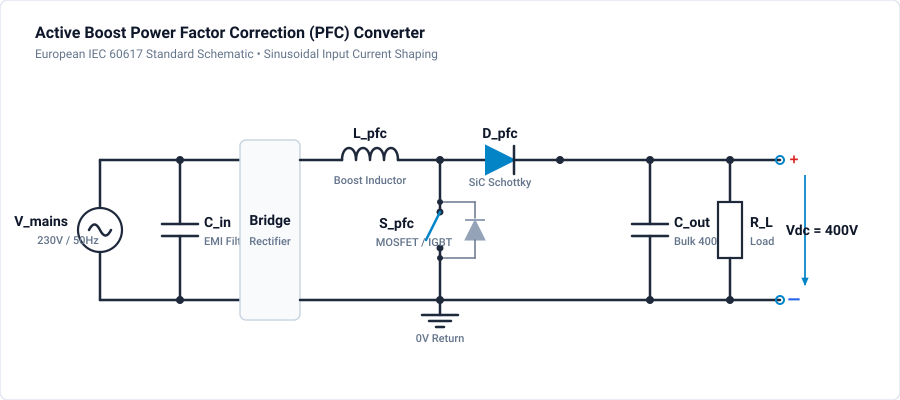

# 302 - PFC Basics

Power Factor Correction fundamentals using boost converter topology.

## Overview

PFC circuits shape the input current to be sinusoidal and in phase with the voltage, achieving near-unity power factor and reducing harmonic distortion.

## Why PFC?

Without PFC, rectifiers draw peaky current that:
- Causes harmonic pollution on the grid
- Reduces effective power delivery
- Fails regulatory standards (IEC 61000-3-2)

## Boost PFC Topology

### Circuit Configuration



### Operating Principle

1. **Switch ON:** Inductor charges, current rises
2. **Switch OFF:** Inductor discharges through diode to output
3. **Current Shaping:** PWM duty cycle modulated to make current follow voltage

## Control Methods

### Average Current Mode Control

- Current loop tracks reference derived from voltage
- Excellent current waveform
- Complex implementation

### Critical Conduction Mode (CRM)

- Variable frequency operation
- Zero-current switching
- Simpler implementation
- Higher peak currents

## Key Equations

**Duty Cycle (CCM):**

$$
D = 1 - \frac{V_{in}(t)}{V_{out}}
$$

**Inductor Current Ripple:**

$$
\Delta I_L = \frac{V_{in} \cdot D}{L \cdot f_{sw}}
$$

**Power Factor:**

$$
PF = \frac{P}{S} = \frac{V_{rms} \cdot I_{rms} \cdot \cos\phi}{V_{rms} \cdot I_{rms}}
$$

## Design Parameters

| Parameter | Typical Value | Notes |
|-----------|---------------|-------|
| Output Voltage | 385-400V DC | Above peak AC |
| Switching Freq | 65-130 kHz | EMI tradeoffs |
| Inductor | 200-500µH | Ripple control |
| Output Cap | 200-400µF | Holdup time |

## Simulation & Project File

A complete, production-grade 2-phase interleaved boost PFC project file is provided directly in this directory:

- **Project File**: [:material-download: boost-pfc.ipes](boost-pfc.ipes)

### Interleaved PFC Architecture & Digital Control

This circuit incorporates advanced power electronics features:

1. **Two-Phase Interleaving ($180^\circ$ Phase Shift)**:
   - Two parallel boost stages ($L_1 = 200\,\mu\text{H}$, $L_2 = 200\,\mu\text{H}$) switch at $f_{sw} = 70\,\text{kHz}$.
   - Gate signals `gate1` and `gate2` are interleaved by half a switching period ($T_{sw}/2 \approx 7.14\,\mu\text{s}$), which cancels high-frequency inductor current ripple at the input rectifier and output capacitor.

2. **Embedded Microcontroller Script PI Controller (`CTRL_SCRIPT_PFC`)**:
   - Implements digital discrete-time PI feedback:
     ```c
     // Voltage loop error
     error = V_ref - uOUT;
     integrator += Ki * error * dt;
     // Anti-windup clamping
     if (integrator > 0.90) integrator = 0.90;
     if (integrator < 0.05) integrator = 0.05;
     duty = Kp * error + integrator;
     ```
   - Sets duty cycle dynamically to regulate the output bus at precisely $400\text{ V DC}$.

3. **Dynamic Load Step Verification**:
   - A secondary load switch (`S_LOAD`) switches on at $t = 30\,\text{ms}$.
   - Tests closed-loop transient recovery, showing the PI controller correcting for load droop within a few line cycles.

### Simulation Specifications

| Parameter | Value |
| :--- | :--- |
| **Input AC Source** | 230 V RMS / 50 Hz |
| **Target Output Voltage** | 400.0 V DC |
| **Rated Power** | 3.5 kW |
| **Boost Inductors** | $L_1 = L_2 = 200\,\mu\text{H}$ |
| **Output Capacitor** | $C_{out} = 470\,\mu\text{F}$ |
| **Switching Frequency** | $70\,\text{kHz}$ |
| **Simulation Step $\Delta t$** | $1.0\,\mu\text{s}$ |
| **Total Duration** | $60\,\text{ms}$ (60,000 steps) |
| **Monitored Waveforms** | `uOUT`, `gate1`, `gate2`, `gate_load`, `v_out_telemetry`, `duty_telemetry` |

### How to Run in GeckoCIRCUITS

1. Open `boost-pfc.ipes` in GeckoCIRCUITS desktop or run via MCP `gecko_simulate`.
2. Press **F5** to start simulation.
3. Open the **Scope** view to observe:
   - Soft-start output bus ramp up to $400\text{ V}$.
   - Output voltage dip and rapid PI controller recovery when the load step triggers at $t = 30\,\text{ms}$.
   - Balanced interleaved gate pulses `gate1` and `gate2`.

## Related Resources

- [301 - Diode Rectifier](diode-rectifier.md) - Basic uncontrolled rectification
- [303 - Vienna Rectifier](vienna-rectifier.md) - Three-phase three-level PFC
- [304 - 230V to 3.3V SMPS Guide](230v-to-3v3-smps-guide.md) - Offline power supply design
