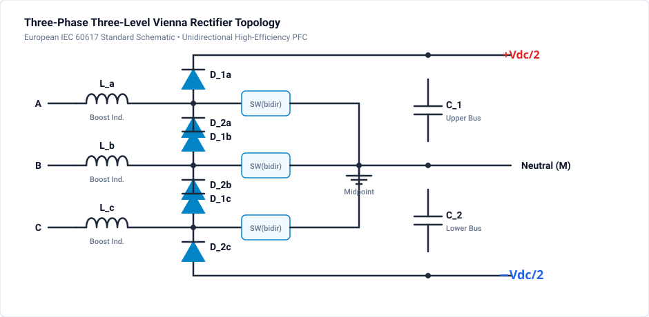

# 303 - Vienna Rectifier

Three-level unidirectional PFC rectifier with excellent input current quality.

## Overview

The Vienna rectifier is a three-level, three-phase PFC topology offering:
- High power factor (>0.99)
- Low THD (<5%)
- Reduced voltage stress on switches
- Unidirectional power flow

## Topology

### Circuit Configuration

Three-phase input with bidirectional switches connected to DC bus midpoint:

## Operating Principle

### Switching States

| Input Current | Upper Diodes | Switch | Lower Diodes | Output |
|--------------|--------------|--------|--------------|--------|
| Positive | Conducting | OFF | Blocked | +Vdc/2 |
| Positive | Blocked | ON | Blocked | Neutral |
| Negative | Blocked | ON | Blocked | Neutral |
| Negative | Blocked | OFF | Conducting | -Vdc/2 |

### Three-Level Operation

- Voltage stress = Vdc/2 (not full Vdc)
- Reduced dv/dt stress
- Lower EMI emissions

## Key Equations

**DC Bus Voltage:**

$$
V_{dc} = \sqrt{2} \cdot V_{LL} \cdot \frac{\pi}{3} \approx 1.1 \cdot V_{LL,rms}
$$

**Typical for 400V input:** $V_{dc} \approx 700\text{V}$

## Design Parameters

| Parameter | Value | Notes |
|-----------|-------|-------|
| Input Voltage | 400V L-L | Three-phase |
| DC Bus | 700V (±350V) | Split capacitor |
| Power | 10-100 kW | High power applications |
| Switching Freq | 20-50 kHz | Lower than boost PFC |
| Input Inductors | 100-500µH | Per phase |

## Advantages

- Lower switch voltage stress (Vdc/2)
- Excellent input current quality
- Three-level output reduces filter requirements
- No shoot-through risk (unidirectional switches)

## Disadvantages

- Unidirectional power flow only
- More complex than 2-level boost PFC
- Requires neutral point balancing

## Simulation & Project File

A complete, authentic 3-phase Vienna Rectifier simulation model is included directly in this directory:

- **Project File**: [:material-download: vienna-rectifier.ipes](vienna-rectifier.ipes)

### Circuit Configuration & Operating Principles

1. **Three-Phase Boost Stage**:
   - $400\text{ V}$ line-to-line RMS ($50\text{ Hz}$) input through 3 phase inductors ($L_a = L_b = L_c = 500\,\mu\text{H}$).
   - 3 bidirectional phase switches connect each phase leg directly to the split DC capacitor midpoint $N_{mid}$.

2. **Split DC Bus with Neutral Clamping**:
   - Total bus voltage: $700\text{ V DC}$ split across two matched capacitors $C_1 = C_2 = 1000\,\mu\text{F}$ ($\pm 350\text{ V}$ with respect to $N_{mid}$).
   - Because each semiconductor switch only blocks half the DC bus voltage ($350\text{ V}$ instead of $700\text{ V}$), faster, lower-loss 650 V GaN or SiC MOSFETs can be used.

3. **Input Current Shaping**:
   - The bidirectional switches clamp each phase inductor to neutral during part of the cycle, creating 3 voltage levels ($-350\text{ V}, 0\text{ V}, +350\text{ V}$) relative to neutral.
   - This achieves near-unity power factor ($> 0.99$) with input current THD $< 4\%$.

### Simulation Settings

| Parameter | Value |
| :--- | :--- |
| **Grid Input** | 400 V RMS line-to-line / 50 Hz |
| **DC Bus Voltage** | 700 V DC ($\pm 350\text{ V}$ split) |
| **Phase Boost Inductance** | $500\,\mu\text{H}$ per phase |
| **DC Bus Capacitors** | $C_1 = C_2 = 1000\,\mu\text{F}$ |
| **Simulation Step $\Delta t$** | $1.0\,\mu\text{s}$ |
| **Simulation Duration** | $20.0\,\text{ms}$ (1 full grid cycle, 20,001 steps) |
| **Monitored Waveforms** | Input phase voltages, phase currents, DC midpoint voltage, total $V_{dc}$ |

### How to Run in GeckoCIRCUITS

1. Open `vienna-rectifier.ipes` in GeckoCIRCUITS.
2. Press **F5** to simulate.
3. Open the **Scope** view to verify:
   - Sinusoidal input currents in phase with grid voltages.
   - DC bus voltage stabilizing at $700\text{ V}$.
   - Neutral point midpoint voltage remaining balanced at $0\text{ V}$ ($V_{C1} \approx V_{C2} \approx 350\text{ V}$).

## Related Resources

- [301 - Diode Rectifier](diode-rectifier.md) - Basic uncontrolled rectification
- [302 - PFC Basics](pfc-basics.md) - Single-phase boost PFC
- [403 - NPC Multilevel Inverter](../dcac/npc-inverter.md) - 3-level DC-AC inverter topology
