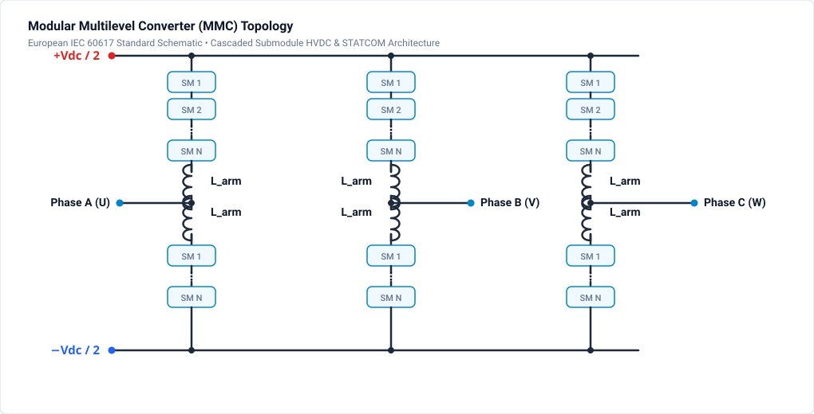
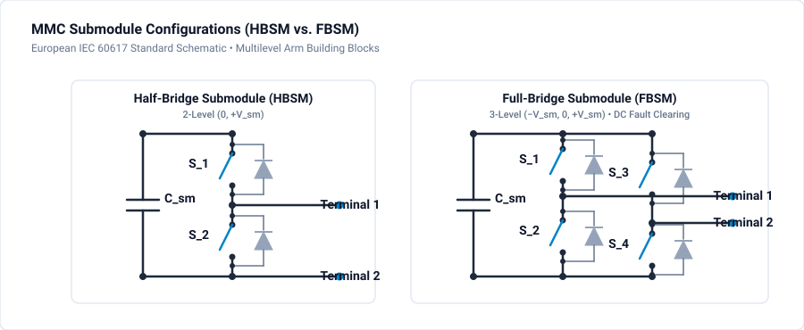

# 404 - Modular Multilevel Converter

Scalable multilevel topology for HVDC and FACTS applications.

## Overview

The Modular Multilevel Converter (MMC) is the state-of-the-art topology for:
- HVDC transmission (±320kV to ±525kV)
- STATCOM systems
- High-power motor drives
- Battery energy storage systems (BESS)

## Topology

### Structure

### Submodule Types

- **Half-Bridge SM (HBSM):** Output is $0$ or $+V_c$ (Unipolar capability, lowest conduction losses).
- **Full-Bridge SM (FBSM):** Output is $-V_c, 0,$ or $+V_c$ (Bipolar capability, DC short-circuit fault-blocking capability).

## Operating Principle

### Voltage Synthesis
- N submodules per arm
- Insert/bypass SMs to create voltage steps
- Output voltage = Vdc/2 - (inserted SMs × Vc)

### Current Path
- Upper + Lower arm currents combine at output
- Circulating current flows within converter
- Arm inductors limit circulating current

## Key Equations

**Submodule Voltage:**

$$
V_{SM} = \frac{V_{dc}}{N}
$$

**Number of Levels:**

$$
N_{levels} = N + 1 \quad \text{(per arm)}
$$

**Arm Current:**

$$
i_{arm} = \frac{i_{dc}}{3} + \frac{i_{ac}}{2} + i_{circ}
$$

**Energy Storage:**

$$
E_{stored} = 6 \cdot N \cdot \frac{1}{2}CV_{SM}^2
$$

## Control Architecture

### Hierarchical Control

1. **System Level**
   - Active/reactive power control
   - DC voltage control

2. **Converter Level**
   - Circulating current control
   - Capacitor voltage balancing (average)

3. **Arm Level**
   - Individual SM capacitor balancing
   - Sorting algorithm (NLM or PWM)

### Modulation Methods

**Nearest Level Modulation (NLM):**
- Round reference to nearest level
- Very low switching frequency
- Used in HVDC

**Phase-Shifted Carrier PWM:**
- Higher effective switching frequency
- Better harmonic performance
- Used in motor drives

## Design Parameters

| Parameter | HVDC | Motor Drive |
|-----------|------|-------------|
| DC Voltage | ±320-525kV | 3-35kV |
| Submodules/Arm | 200-400 | 10-40 |
| SM Capacitance | 8-15mF | 2-5mF |
| Arm Inductance | 50-100mH | 1-10mH |
| SM Type | Half-bridge | Full-bridge |

## Simulation & Project File

A complete, simulated and verified Modular Multilevel Converter (MMC) project file is provided directly in this directory:

- **Project File**: [:material-download: mmc-converter.ipes](mmc-converter.ipes)

### MMC Phase Leg Architecture & Operation

1. **High-Voltage DC Link ($\pm 5\text{ kV}$ DC)**:
   - Positive DC pole at $+5.0\text{ kV}$ DC, negative DC pole at $-5.0\text{ kV}$ DC ($10.0\text{ kV}$ total DC bus), centered around neutral ground reference `0`.

2. **Upper & Lower Half-Bridge Submodules (HBSM)**:
   - **Upper Arm**:
     - Submodule switches `S_u1` and `S_u2` with energy storage capacitor $C_{u} = 2000\,\mu\text{F}$.
     - Upper arm buffer inductor $L_{arm,u} = 10.0\,\text{mH}$ connecting from upper arm node `arm_up` to AC output terminal `ac_node`.
   - **Lower Arm**:
     - Submodule switches `S_l1` and `S_l2` with energy storage capacitor $C_{l} = 2000\,\mu\text{F}$.
     - Lower arm buffer inductor $L_{arm,l} = 10.0\,\text{mH}$ connecting from AC output terminal `ac_node` to lower arm node `arm_lo`.

3. **Submodule Insertion & Bypass States**:
   - **Inserted State ($v_{SM} = +V_c$)**: `S1`=ON, `S2`=OFF. The capacitor is inserted into the arm path. Arm current flows through the capacitor, charging or discharging it depending on current polarity.
   - **Bypassed State ($v_{SM} = 0$)**: `S1`=OFF, `S2`=ON. Current flows entirely through `S2`, bypassing the capacitor and holding its stored voltage constant.

4. **Arm Inductor Function**:
   - Limits inter-arm circulating currents caused by instantaneous voltage mismatches between upper and lower inserted submodules.
   - Decouples the DC bus from the synthesized AC grid terminal `ac_node`.

### Simulation Specifications

| Parameter | Value |
| :--- | :--- |
| **DC Pole-to-Pole Voltage** | 10.0 kV DC ($\pm 5.0\text{ kV}$) |
| **Submodule Capacitors** | $C_u = C_l = 2.0\,\text{mF}$ |
| **Arm Inductors** | $L_{arm,u} = L_{arm,l} = 10.0\,\text{mH}$ |
| **AC Load Resistance** | $R_{ac} = 50.0\,\Omega$ |
| **Fundamental Frequency** | 50 Hz |
| **Simulation Step $\Delta t$** | $1.0\,\mu\text{s}$ |
| **Duration** | $40.0\,\text{ms}$ (40,000 steps, 2 full cycles) |
| **Monitored Signals** | `v_ac`, `i_ac`, `i_arm_up`, `g_u1`, `g_u2`, `g_l1`, `g_l2` |

### How to Run in GeckoCIRCUITS

1. Open `mmc-converter.ipes` in GeckoCIRCUITS.
2. Press **F5** to start simulation.
3. Open the **Scope** view to observe:
   - AC output voltage (`v_ac`) and AC load current (`i_ac`) synthesized by complementary submodule switching.
   - Upper arm current (`i_arm_up`) showing the DC component ($I_{dc}/3$) superimposed with the AC component ($I_{ac}/2$).
   - Synchronized gate firing signals `g_u1`, `g_u2`, `g_l1`, `g_l2`.

## Related Resources

- [403 - NPC Multilevel Inverter](npc-inverter.md) - 3-level diode-clamped converter
- [402 - Three-Phase Inverter](three-phase.md) - Standard 2-level 3-phase inverter
