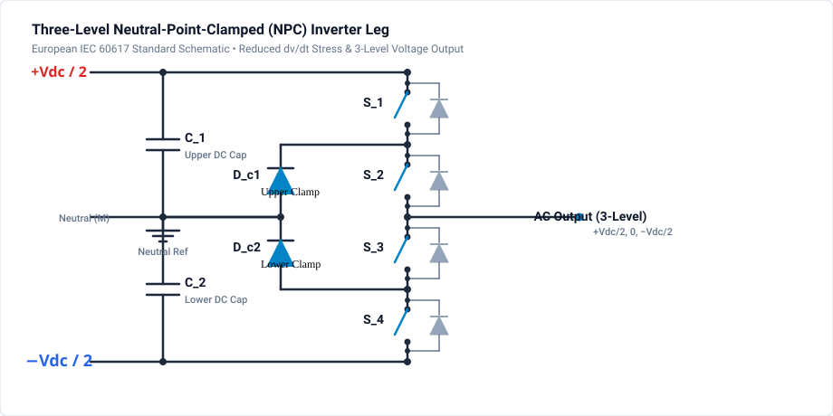

# 403 - NPC Multilevel Inverter

Neutral-Point-Clamped three-level inverter topology.

## Overview

The NPC inverter produces three voltage levels per phase, offering:
- Reduced harmonic distortion
- Lower dv/dt stress
- Smaller output filters
- Higher efficiency at medium voltage

## Topology

### Single-Phase Leg

### Switching States

| State | S1 | S2 | S3 | S4 | Output |
|-------|----|----|----|----|--------|
| P | ON | ON | OFF | OFF | +Vdc/2 |
| O | OFF | ON | ON | OFF | 0 |
| N | OFF | OFF | ON | ON | -Vdc/2 |

## Key Advantages

### Voltage Stress
- Each switch blocks only Vdc/2
- Enables use of lower voltage devices
- Higher reliability

### Output Quality
- 3-level output waveform
- Lower dv/dt (smaller steps)
- Reduced EMI emissions
- Smaller output filter

## Neutral Point Balancing

### The Challenge
- Capacitor voltage imbalance causes distortion
- Imbalance occurs with non-unity power factor
- Requires active control strategy

### Balancing Methods

1. **Carrier-based PWM with offset**
   - Add zero-sequence component
   - Simple implementation

2. **Space Vector PWM**
   - Select redundant vectors strategically
   - Better utilization

3. **Direct voltage control**
   - Measure capacitor voltages
   - Adjust modulation in real-time

## Key Equations

**Output Voltage Levels:**

$$
V_{out} \in \{-V_{dc}/2, 0, +V_{dc}/2\}
$$

**Modulation Index:**

$$
m_a = \frac{V_{ref,peak}}{V_{dc}/2}
$$

**Switching Frequency per Device:**
- Lower than 2-level (each switch operates part of cycle)
- Reduces switching losses

## Design Parameters

| Parameter | Typical Value |
|-----------|---------------|
| DC Bus | 600-1200V |
| Split Capacitors | 2× matched |
| Clamping Diodes | Fast recovery |
| Switching Freq | 2-10 kHz |

## Applications

- Medium voltage drives (2.3-6.6 kV)
- Grid-tied inverters (MW scale)
- HVDC converters
- Railway traction

## Simulation & Project File

A complete, simulated and verified 3-Level Neutral-Point-Clamped (NPC) Inverter project file is provided directly in this directory:

- **Project File**: [:material-download: npc-inverter.ipes](npc-inverter.ipes)

### NPC Phase Leg Architecture & Commutation

1. **Split DC Bus ($800\text{ V DC}$)**:
   - Formed by two matched capacitors $C_1 = C_2 = 1000\,\mu\text{F}$ with the midpoint tied to reference ground `0`.
   - Positive DC rail at $+400\text{ V}$, negative DC rail at $-400\text{ V}$.

2. **Four Series Switches & Neutral Clamping Diodes**:
   - `S1` connected between $+400\text{ V}$ and node `n1`.
   - `S2` connected between node `n1` and switch output `sw_out`.
   - `S3` connected between switch output `sw_out` and node `n2`.
   - `S4` connected between node `n2` and $-400\text{ V}$.
   - Clamping diode `D_clamp1` connects neutral ground to `n1`.
   - Clamping diode `D_clamp2` connects `n2` to neutral ground.

3. **Commutation States**:
   - **State P ($+400\text{ V}$)**: S1=ON, S2=ON. Terminal connects to $+400\text{ V}$. Diodes reverse biased.
   - **State O ($0\text{ V}$)**: S2=ON, S3=ON. Terminal clamps to neutral: if load current is positive, it circulates through S3 and `D_clamp2`; if negative, through S2 and `D_clamp1`.
   - **State N ($-400\text{ V}$)**: S3=ON, S4=ON. Terminal connects to $-400\text{ V}$.
   - Crucially, no switch ever experiences more than $V_{dc}/2 = 400\text{ V}$ across its terminals.

4. **Output Filter & Load**:
   - Filter inductor $L_1 = 2.0\,\text{mH}$ and capacitor $C_{filt} = 10.0\,\mu\text{F}$.
   - Output load $R = 20\,\Omega$.

### Simulation Specifications

| Parameter | Value |
| :--- | :--- |
| **Total DC Voltage** | 800 V DC ($\pm 400\text{ V}$ split) |
| **Split Capacitors** | $C_1 = C_2 = 1000\,\mu\text{F}$ |
| **Switching Carrier** | 10 kHz Level-Shifted SPWM |
| **Fundamental Frequency** | 50 Hz |
| **Filter Components** | $L = 2.0\,\text{mH}$, $C = 10.0\,\mu\text{F}$ |
| **Load Resistance** | $20\,\Omega$ |
| **Simulation Step $\Delta t$** | $1.0\,\mu\text{s}$ |
| **Duration** | $40.0\,\text{ms}$ (40,000 steps, 2 full cycles) |
| **Monitored Signals** | `v_out`, `i_load`, `v_c1`, `v_c2`, `g1`, `g2`, `g3`, `g4` |

### How to Run in GeckoCIRCUITS

1. Open `npc-inverter.ipes` in GeckoCIRCUITS.
2. Press **F5** to start simulation.
3. Open the **Scope** view to verify:
   - 3-level switched output voltage transitioning through $+400\text{ V}$, $0\text{ V}$, and $-400\text{ V}$.
   - Filtered output voltage (`v_out`) and load current (`i_load`) forming a pure $50\text{ Hz}$ sine wave.
   - Balanced split capacitor voltages (`v_c1` and `v_c2`) holding steady at $400\text{ V}$.

## Related Resources

- [402 - Three-Phase Inverter](three-phase.md) - Standard 2-level inverter
- [404 - MMC Converter](mmc-converter.md) - Modular Multilevel Converter with scalable submodules
- [303 - Vienna Rectifier](../acdc/vienna-rectifier.md) - 3-level active PFC rectifier
