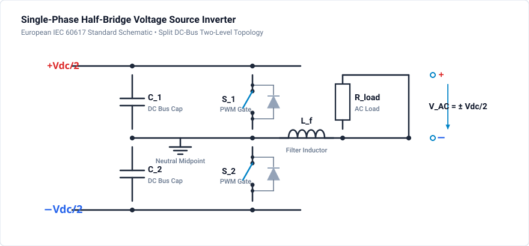
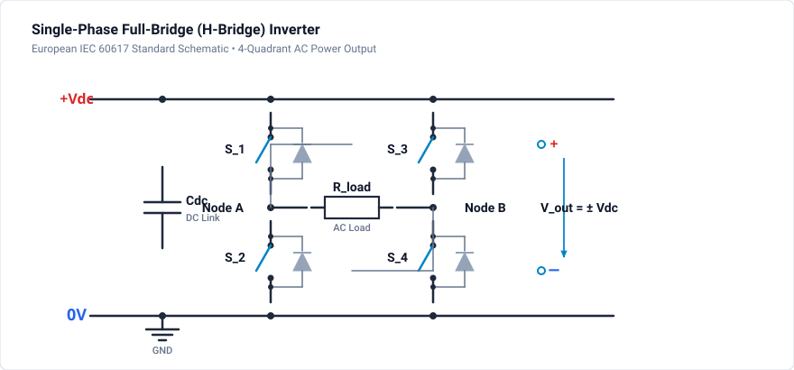

# 401 - Single-Phase Inverter

PWM inverter fundamentals for DC-AC conversion.

## Overview

Single-phase inverters convert DC to AC using PWM switching strategies, essential for:
- UPS systems
- Solar inverters (residential)
- Motor drives (single-phase)
- AC power supplies

## Topologies

### Half-Bridge Inverter

**Output:** $\pm V_{dc}/2$

### Full-Bridge (H-Bridge) Inverter

**Output:** $\pm V_{dc}$

## PWM Strategies

### Bipolar PWM

- Compare sine reference to triangle carrier
- S1-S4 switch together, S2-S3 switch together
- Output levels: $+V_{dc}, -V_{dc}$

### Unipolar PWM

- Two reference signals (positive and negative)
- Each leg switched independently
- Output levels: $+V_{dc}, 0, -V_{dc}$
- Lower harmonic content, reduced filter size

## Key Equations

**Modulation Index:**

$$
m_a = \frac{V_{ref,peak}}{V_{carrier,peak}}
$$

**Fundamental Output Voltage (linear region):**

$$
V_{out,1} = m_a \cdot V_{dc} \quad \text{(full-bridge)}
$$

**THD Calculation:**

$$
THD = \frac{\sqrt{V_2^2 + V_3^2 + \dots + V_n^2}}{V_1}
$$

## Design Parameters

| Parameter | Typical Value |
|-----------|---------------|
| DC Bus | 400V (from PFC) |
| Switching Freq | 10-50 kHz |
| Output Filter L | 1-5 mH |
| Output Filter C | 2-10 µF |
| Modulation Index | 0.8-0.95 |

## Simulation & Project File

A complete, simulated and verified Single-Phase H-Bridge Inverter project file is provided directly in this directory:

- **Project File**: [:material-download: single-phase-inverter.ipes](single-phase-inverter.ipes)

### Power Stage & Modulation Specifications

1. **H-Bridge Switching Matrix**:
   - 4 switches (`S1`, `S2`, `S3`, `S4`) driven by complementary gate signals.
   - S1 and S4 conduct together for positive phase output $+V_{dc}$; S2 and S3 conduct together for negative phase output $-V_{dc}$.
   - $V_{dc} = 400.0\text{ V DC}$ standard industrial DC bus.

2. **LC Low-Pass Filter Design**:
   - Filter inductor $L_1 = 2.0\,\text{mH}$ and filter capacitor $C_1 = 10.0\,\mu\text{F}$.
   - Resonant cutoff frequency:
     $$f_c = \frac{1}{2\pi \sqrt{L_1 C_1}} = \frac{1}{2\pi \sqrt{2.0\times 10^{-3} \times 10.0\times 10^{-6}}} \approx 1.125\,\text{kHz}$$
   - Attenuates the $20\,\text{kHz}$ switching ripple by $> 40\,\text{dB}$ while preserving the $50\,\text{Hz}$ fundamental sine wave.

3. **Output & Load**:
   - Pure resistive load $R_1 = 20\,\Omega$.
   - Output voltage: $230\text{ V RMS}$ at $50\text{ Hz}$ ($V_{\text{peak}} \approx 325\text{ V}$).
   - Output current: $\approx 11.5\text{ A RMS}$ ($16.3\text{ A peak}$).

### Simulation Parameters

| Setting | Value |
| :--- | :--- |
| **DC Bus Voltage** | 400 V DC |
| **Carrier Frequency** | 20 kHz |
| **Fundamental Frequency** | 50 Hz |
| **Modulation Index ($m_a$)** | 0.8125 ($V_{\text{peak}} = 325\text{ V}$) |
| **Simulation Step $\Delta t$** | $1.0\,\mu\text{s}$ |
| **Duration** | $40.0\,\text{ms}$ (40,000 steps, 2 full cycles) |
| **Monitored Signals** | `v_ac`, `i_load`, `v_dc`, `g1`, `g2`, `g3`, `g4` |

### How to Run in GeckoCIRCUITS

1. Open `single-phase-inverter.ipes` in GeckoCIRCUITS.
2. Press **F5** to start simulation.
3. Open the **Scope** view to inspect:
   - Clean sinusoidal AC output voltage (`v_ac`) centered at 0 V with peak amplitude $\approx 325\text{ V}$.
   - Load current (`i_load`) strictly in phase with `v_ac`.
   - Gate pulses `g1..g4` demonstrating high-frequency PWM switching at 20 kHz.

## Related Resources

- [402 - Three-Phase Inverter](three-phase.md) - 3-phase two-level inverter
- [403 - NPC Multilevel Inverter](npc-inverter.md) - 3-level Neutral-Point-Clamped topology
- [404 - MMC Converter](mmc-converter.md) - Modular Multilevel Converter
