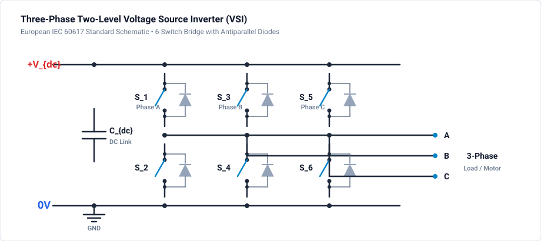
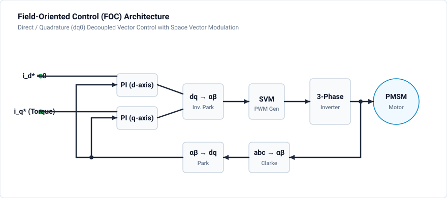

# 402 - Three-Phase Inverter

Three-phase voltage source inverter (VSI) for motor drives and grid-tied applications.

## Overview

Three-phase VSIs are the backbone of:
- AC motor drives (industrial, EV)
- Grid-tied solar/wind inverters
- Active power filters
- STATCOM/FACTS devices

## Topology

### Two-Level VSI

## Space Vector PWM (SVPWM)

### Switching States

| State | S1 | S3 | S5 | Vector |
|-------|----|----|----| -------|
| V0 | 0 | 0 | 0 | Zero |
| V1 | 1 | 0 | 0 | Active |
| V2 | 1 | 1 | 0 | Active |
| V3 | 0 | 1 | 0 | Active |
| V4 | 0 | 1 | 1 | Active |
| V5 | 0 | 0 | 1 | Active |
| V6 | 1 | 0 | 1 | Active |
| V7 | 1 | 1 | 1 | Zero |

### SVPWM Algorithm

1. Calculate reference vector in $\alpha$-$\beta$ frame
2. Identify sector (1-6)
3. Calculate dwell times for adjacent vectors
4. Generate switching sequence

## Key Equations

**DC Bus Utilization:**

- **Sine PWM:**

$$
V_{LL,max} = \frac{\sqrt{3}}{2} V_{dc} \approx 0.866 \cdot V_{dc}
$$

- **SVPWM:**

$$
V_{LL,max} = \frac{V_{dc}}{\sqrt{3}} \approx 1.15 \cdot V_{LL,max(\text{SPWM})}
$$

**15% more DC bus utilization with SVPWM**

**Clarke Transform:**

$$
\begin{bmatrix} v_\alpha \\ v_\beta \end{bmatrix} = \frac{2}{3}\begin{bmatrix} 1 & -\frac{1}{2} & -\frac{1}{2} \\ 0 & \frac{\sqrt{3}}{2} & -\frac{\sqrt{3}}{2} \end{bmatrix} \begin{bmatrix} v_a \\ v_b \\ v_c \end{bmatrix}
$$

## Design Parameters

| Parameter | Motor Drive | Grid-Tied |
|-----------|-------------|-----------|
| DC Bus | 300-800V | 700-1500V |
| Switching Freq | 5-20 kHz | 10-50 kHz |
| Dead Time | 1-3 µs | 0.5-2 µs |
| Output Filter | Motor inductance | LCL filter |

## Control Architecture

## Simulation & Project File

A complete, simulated and verified 3-phase Voltage Source Inverter project file is provided directly in this directory:

- **Project File**: [:material-download: three-phase-inverter.ipes](three-phase-inverter.ipes)

### Power Stage & Modulation Architecture

1. **Two-Level 6-Switch Bridge**:
   - 3 phase legs with complementary switch pairs:
     - Phase A: Upper `S1`, Lower `S4`
     - Phase B: Upper `S3`, Lower `S6`
     - Phase C: Upper `S5`, Lower `S2`
   - $700.0\text{ V DC}$ DC bus voltage (typical for grid-tied inverters and industrial 400 V motor drives).

2. **Sinusoidal Pulse-Width Modulation (SPWM)**:
   - Three reference sinusoids shifted by $120^\circ$ ($0^\circ, -120^\circ, +120^\circ$) at fundamental frequency $f_0 = 50\text{ Hz}$.
   - Modulated against a $10\text{ kHz}$ high-frequency triangular carrier.

3. **Output LC Filter & Star Load**:
   - 3-phase inductors $L_a = L_b = L_c = 2.0\,\text{mH}$.
   - 3-phase filter capacitors $C_a = C_b = C_c = 10.0\,\mu\text{F}$.
   - Balanced star-connected resistive load $R_a = R_b = R_c = 15.0\,\Omega$ connected to virtual neutral star point `star_n`.
   - Attenuates 10 kHz switching harmonics while delivering clean 3-phase sinusoidal currents.

### Simulation Specifications

| Setting | Value |
| :--- | :--- |
| **DC Bus Voltage** | 700 V DC |
| **Carrier Frequency** | 10 kHz |
| **Fundamental Frequency** | 50 Hz |
| **Phase Inductors** | $2.0\,\text{mH}$ per phase |
| **Filter Capacitors** | $10.0\,\mu\text{F}$ per phase |
| **Load Resistance** | $15.0\,\Omega$ per phase (star) |
| **Simulation Step $\Delta t$** | $1.0\,\mu\text{s}$ |
| **Duration** | $40.0\,\text{ms}$ (40,000 steps, 2 full 50 Hz cycles) |
| **Monitored Signals** | `v_phase_a`, `v_phase_b`, `v_phase_c`, `i_load_a`, `g1`..`g6` |

### How to Run in GeckoCIRCUITS

1. Open `three-phase-inverter.ipes` in GeckoCIRCUITS.
2. Press **F5** to start simulation.
3. Open the **Scope** view to verify:
   - Three balanced sinusoidal phase voltages (`v_phase_a`, `v_phase_b`, `v_phase_c`) with exact $120^\circ$ phase displacements.
   - Smooth sinusoidal Phase A load current (`i_load_a`).
   - Symmetrical gate drive pulses `g1..g6` switching at 10 kHz.

## Related Resources

- [401 - Single-Phase Inverter](single-phase.md) - Single-phase H-bridge inverter
- [403 - NPC Multilevel Inverter](npc-inverter.md) - 3-level Neutral-Point-Clamped inverter
- [404 - MMC Converter](mmc-converter.md) - Modular Multilevel Converter for HVDC
