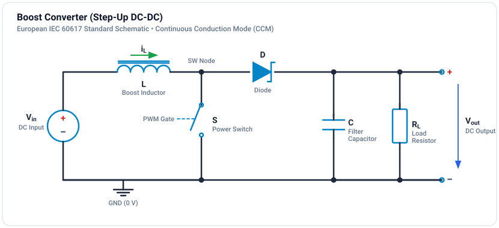

# Tutorial: Boost Converter

Design and simulate a boost (step-up) DC-DC converter.

**Difficulty:** Beginner (1/3) | **Duration:** 30 minutes

**Circuit file:** `resources/tutorials/2xx_dcdc_converters/202_boost_converter/boost_simple.ipes`

## Learning Objectives

- [ ] Understand boost converter operation
- [ ] Calculate output voltage and component values
- [ ] Simulate and verify the design
- [ ] Analyze voltage and current waveforms

## Theory

### Topology

The boost converter steps up DC voltage:

### Operating Principle

**Switch ON (0 < t < D·T):**
Inductor charges from V_in, diode is reverse-biased, capacitor supplies load.

$$V_L = V_{in}, \quad \frac{di_L}{dt} = \frac{V_{in}}{L}$$

**Switch OFF (D·T < t < T):**
Inductor discharges through diode to load and capacitor.

$$V_L = V_{in} - V_{out}, \quad \frac{di_L}{dt} = \frac{V_{in} - V_{out}}{L}$$

### Key Equations

**Voltage conversion ratio (CCM):**

$$\frac{V_{out}}{V_{in}} = \frac{1}{1-D}$$

**Minimum inductance for CCM:**

$$L_{min} = \frac{D(1-D)^2 R}{2f_{sw}}$$

**Output voltage ripple:**

$$\frac{\Delta V_{out}}{V_{out}} = \frac{D}{R C f_{sw}}$$

**Inductor current ripple:**

$$\Delta i_L = \frac{V_{in} \cdot D}{L \cdot f_{sw}}$$

## Design Example

### Specifications

| Parameter | Value |
|-----------|-------|
| Input voltage | 12 V |
| Output voltage | 24 V |
| Output power | 24 W |
| Switching frequency | 100 kHz |
| Max voltage ripple | 1% |

### Calculations

**Duty cycle:**

$$D = 1 - \frac{V_{in}}{V_{out}} = 1 - \frac{12}{24} = 0.5$$

**Load resistance:**

$$R = \frac{V_{out}^2}{P_{out}} = \frac{24^2}{24} = 24\ \Omega$$

**Minimum inductance:**

$$L_{min} = \frac{0.5 \times 0.5^2 \times 24}{2 \times 100k} = 15\ \mu H$$

Choose L = 100 uH (well above minimum for low ripple).

**Output capacitor:**

$$C = \frac{D}{R \times \frac{\Delta V}{V} \times f_{sw}} = \frac{0.5}{24 \times 0.01 \times 100k} = 20.8\ \mu F$$

Choose C = 47 uF.

## Simulation

## Simulation & Project File

A complete, simulated and verified Boost Converter project file is provided directly in this directory:

- **Project File**: [:material-download: boost-converter.ipes](boost-converter.ipes)

### Simulation Model Specifications

| Parameter | Value | Description |
| :--- | :--- | :--- |
| **Input Voltage ($V_{in}$)** | 12.0 V DC | Clean DC voltage source |
| **Duty Cycle ($D$)** | 0.50 | 50% duty ratio ($V_{out} = \frac{V_{in}}{1-D} = 24.0\text{ V}$) |
| **Switching Frequency ($f_s$)** | 50 kHz | Period $T_s = 20\,\mu\text{s}$ |
| **Boost Inductor ($L_1$)** | $100\,\mu\text{H}$ | High-current boost inductor in CCM |
| **Output Capacitor ($C_1$)** | $100\,\mu\text{F}$ | Low-ESR output smoothing capacitor |
| **Load Resistor ($R_1$)** | $10.0\,\Omega$ | Continuous load current $I_{out} = 2.4\text{ A}$ ($P = 57.6\text{ W}$) |
| **Simulation Step $\Delta t$** | $1.0\,\mu\text{s}$ | Fine temporal resolution (20 points per switching cycle) |
| **Simulation Duration** | $15.0\,\text{ms}$ | 15,001 time steps (750 switching periods) |

### Monitored Probe Signals

| Signal | Expected Nominal Value | Description |
| :--- | :--- | :--- |
| `v_out` | $24.0\text{ V DC}$ ($\Delta V \approx 240\text{ mV}_{\text{pp}}$) | Output voltage across load $R_1$ |
| `v_in` | $12.0\text{ V DC}$ | Input supply voltage |
| `i_L` | $4.8\text{ A DC}$ ($\Delta I_L \approx 1.2\text{ A}_{\text{pp}}$) | Inductor current through $L_1$ |
| `i_diode` | Pulsating $0\text{ A} \to 5.4\text{ A}$ | Current through boost diode `D_1` during switch OFF times |
| `pwm` | 50 kHz square wave, $50\%$ duty | Gate driver pulse command |

### How to Run in GeckoCIRCUITS

1. Open `boost-converter.ipes` in GeckoCIRCUITS desktop or simulate via MCP `gecko_simulate`.
2. Press **F5** to run the simulation.
3. Open the **Scope** window to inspect:
   - Output voltage smoothly rising and stabilizing at $24.0\text{ V DC}$.
   - Inductor current continuously flowing in CCM with average value $4.8\text{ A}$.
   - Diode current pulsating during the OFF time $(1-D)T_s$ to deliver power to the load.

## Exercises

### Exercise 1: Duty Cycle Variation
Change D from 0.3 to 0.7 in steps of 0.1. Plot $V_{out}$ vs $D$ and verify:
$$V_{out} = \frac{V_{in}}{1 - D}$$

### Exercise 2: CCM/DCM Boundary
Reduce the load power (increase $R$ to $100\,\Omega$) until the inductor current touches zero. Observe the transition to discontinuous conduction mode.

### Exercise 3: Component Sizing
Change $L_1$ to $50\,\mu\text{H}$. Observe increased current ripple $\Delta I_L = 2.4\text{ A}$ and higher capacitor voltage ripple.

## Important Notes

!!! warning "Boost Converter Limitations"
    - Output is always higher than input ($V_{out} > V_{in}$)
    - As $D$ approaches 1, practical duty cycle is limited by diode and inductor series resistances
    - The boost converter has a Right-Half-Plane (RHP) zero at $\omega_z = \frac{R(1-D)^2}{L}$, limiting the control bandwidth in closed-loop designs
    - Continuous input current makes boost topologies ideal for PFC and solar MPPT applications

## Next Steps

- [Buck-Boost Topologies](buck-boost.md) - Inverting and non-inverting variants
- [Flyback Converter](flyback.md) - Isolated boost-derived topology
- [PFC Boost](../../tutorials/acdc/pfc-basics.md) - Boost converter for power factor correction
