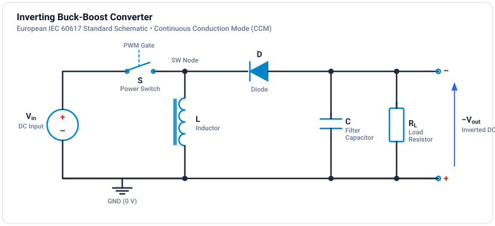
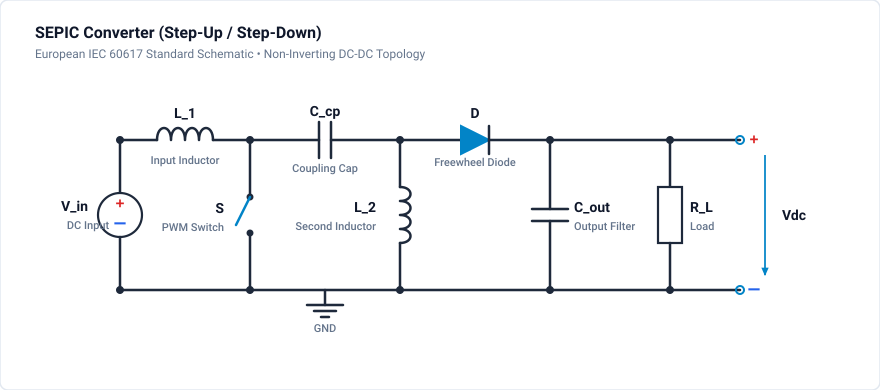
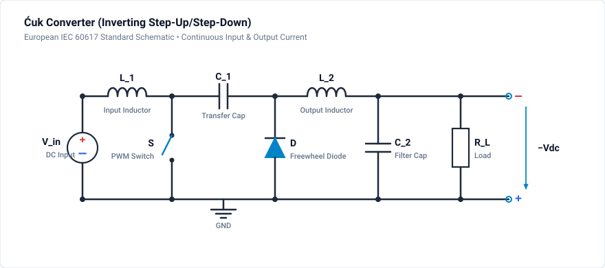

# Tutorial: Buck-Boost Topologies

Explore converter topologies that can both step up and step down voltage.

**Difficulty:** Intermediate (2/3) | **Duration:** 30 minutes

**Circuit files:**
- `resources/tutorials/2xx_dcdc_converters/203_buck_boost/buckBoost_simple.ipes`
- `resources/tutorials/2xx_dcdc_converters/203_buck_boost/cuk_simple.ipes`
- `resources/tutorials/2xx_dcdc_converters/203_buck_boost/sepic_simple.ipes`

## Topologies Covered

| Topology | Output Polarity | Output Range | Continuous Input Current |
|----------|----------------|--------------|------------------------|
| Buck-Boost | Inverted | 0 to -inf | No |
| Cuk | Inverted | 0 to -inf | Yes |
| SEPIC | Non-inverted | 0 to +inf | Yes |

## Inverting Buck-Boost

### Topology

### Voltage Ratio

$$V_{out} = -\frac{D}{1-D} \times V_{in}$$

| D | V_out/V_in | Mode |
|---|-----------|------|
| 0.25 | -0.33 | Step-down |
| 0.50 | -1.00 | Unity |
| 0.75 | -3.00 | Step-up |

!!! note "Inverted Output"
    The basic buck-boost produces a negative output voltage relative to input ground.

## SEPIC Converter

### Topology

The SEPIC (Single-Ended Primary-Inductor Converter) provides non-inverted output:

### Voltage Ratio

Same as buck-boost magnitude, but non-inverted:

$$
V_{out} = \frac{D}{1-D} \times V_{in}
$$

### Advantages

- Non-inverted output
- Continuous input current (good for battery/solar)
- Can step up or step down

### Disadvantages

- Two inductors and coupling capacitor
- Higher component count than buck-boost
- Pulsating output current

## Cuk Converter

### Topology

### Voltage Ratio

$$
V_{out} = -\frac{D}{1-D} \times V_{in}
$$

### Advantages

- Continuous input AND output current
- Low ripple at both ports
- Can couple L1 and L2 on same core

## Design Guidelines

### Coupling Capacitor (SEPIC/Cuk)

$$
C_{coupling} = \frac{I_{out}}{f_{sw} \times \Delta V_C}
$$

Typically 1-10 uF ceramic. Must handle RMS ripple current.

### Inductors

$$
L_1 \geq \frac{V_{in} \times D}{f_{sw} \times \Delta i_{L1}}
$$

$$
L_2 \geq \frac{V_{out} \times (1-D)}{f_{sw} \times \Delta i_{L2}}
$$

## Simulation & Project File

A complete, simulated and verified Inverting Buck-Boost Converter project file is provided directly in this directory:

- **Project File**: [:material-download: buck-boost-converter.ipes](buck-boost-converter.ipes)

### Inverting Buck-Boost Model Specifications

| Parameter | Value | Description |
| :--- | :--- | :--- |
| **Input Voltage ($V_{in}$)** | 24.0 V DC | Clean DC voltage source |
| **Duty Cycle ($D$)** | 0.40 | 40% duty ratio ($V_{out} = -\frac{D}{1-D} V_{in} = -16.0\text{ V}$) |
| **Switching Frequency ($f_s$)** | 50 kHz | Period $T_s = 20\,\mu\text{s}$ |
| **Energy Storage Inductor ($L_1$)** | $150\,\mu\text{H}$ | Inductor connected to ground |
| **Output Smoothing Capacitor ($C_1$)** | $220\,\mu\text{F}$ | Polarized output capacitor |
| **Load Resistor ($R_1$)** | $8.0\,\Omega$ | Continuous load current $|I_{out}| = 2.0\text{ A}$ ($P = 32.0\text{ W}$) |
| **Simulation Step $\Delta t$** | $1.0\,\mu\text{s}$ | Fine temporal resolution |
| **Simulation Duration** | $15.0\,\text{ms}$ | 15,001 time steps (750 switching periods) |

### Monitored Probe Signals

| Signal | Expected Nominal Value | Description |
| :--- | :--- | :--- |
| `v_out` | $\mathbf{-16.0\text{ V DC}}$ ($\Delta V \approx 20\text{ mV}_{\text{pp}}$) | Inverted negative DC output voltage across $R_1$ |
| `v_in` | $+24.0\text{ V DC}$ | Input positive supply rail |
| `i_L` | $3.33\text{ A DC}$ ($\Delta I_L \approx 1.28\text{ A}_{\text{pp}}$) | Inductor current flowing toward ground |
| `pwm` | 50 kHz square wave, $40\%$ duty | Gate driver pulse command |

### How to Run in GeckoCIRCUITS

1. Open `buck-boost-converter.ipes` in GeckoCIRCUITS desktop or simulate via MCP `gecko_simulate`.
2. Press **F5** to run the simulation.
3. Open the **Scope** window to inspect:
   - Output voltage smoothly settling to negative **$-16.0\text{ V DC}$**.
   - Inductor current ramping linearly during switch ON time, and discharging through diode `D_1` into the load during switch OFF time.

## Exercises

### Exercise 1: Step-Up/Step-Down Transition
Sweep D from 0.2 to 0.8:
- For $D < 0.5$ (e.g. $D = 0.4$): $|V_{out}| = 16\text{ V} < V_{in}$ (step-down mode).
- At $D = 0.5$: $|V_{out}| = V_{in} = 24\text{ V}$.
- For $D > 0.5$ (e.g. $D = 0.67$): $|V_{out}| = 48\text{ V} > V_{in}$ (step-up mode).

### Exercise 2: Pulsating Current Stresses
Compare the input and output currents: note that in the buck-boost converter, both input current and output diode current are discontinuous/pulsating, requiring substantial input and output capacitance.

## Next Steps

- [Flyback Converter](flyback.md) - Isolated topology derived from buck-boost
- [Forward Converter](forward.md) - Isolated buck-derived topology
- [Thermal Simulation](../../tutorials/thermal/index.md) - Add loss and thermal analysis
