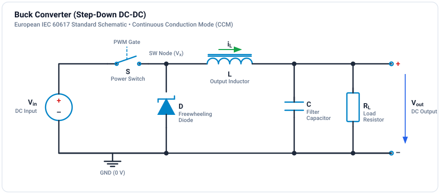

# Tutorial 201: Buck Converter

The buck converter is the fundamental step-down DC-DC topology, efficiently converting a higher voltage to a lower voltage using PWM control.

## Overview

| | |
|---|---|
| **Difficulty** | :material-star::material-star: Intermediate |
| **Duration** | 30-40 minutes |
| **Prerequisites** | [PWM Basics](../../getting-started/pwm-basics.md) |

## Learning Objectives

By the end of this tutorial, you will:

- [x] Understand buck converter operation in CCM and DCM
- [x] Apply the volt-second balance principle
- [x] Calculate output voltage, inductor current ripple, and capacitor voltage ripple
- [x] Design a buck converter for given specifications

## Circuit Topology

**Components:**

- **S** - High-side switch (MOSFET/IGBT)
- **D** - Freewheeling diode (Schottky recommended)
- **L** - Output inductor
- **C** - Output capacitor
- **R** - Load resistance

## Operating Principle

=== "Switch ON"

    - Current path: $V_{in} \to S \to L \to C/R \to \text{GND}$
    - Inductor voltage: $V_L = V_{in} - V_{out}$ (positive)
    - Current increases: $\frac{di_L}{dt} = \frac{V_{in} - V_{out}}{L}$

=== "Switch OFF"

    - Current path: $L \to C/R \to \text{GND} \to D \to L$
    - Inductor voltage: $V_L = -V_{out}$ (negative)
    - Current decreases: $\frac{di_L}{dt} = \frac{-V_{out}}{L}$

## Key Equations

### Output Voltage (Volt-Second Balance)

In steady state, the average inductor voltage is zero:

$$
V_{out} = D \times V_{in}
$$

!!! info "Key Insight"
    Output voltage is directly proportional to duty cycle!

### Inductor Current Ripple

$$
\Delta I_L = \frac{V_{out} \times (1 - D)}{f_s \times L}
$$

### Output Voltage Ripple

$$
\Delta V_{out} = \frac{\Delta I_L}{8 \times f_s \times C}
$$

### Critical Inductance (CCM Boundary)

$$
L_{crit} = \frac{V_{in} \times (1-D) \times D}{2 \times f_s \times I_{out,min}}
$$

## Design Example

### Specifications

| Parameter | Value | Unit |
|-----------|-------|------|
| Input Voltage | 48 | V |
| Output Voltage | 12 | V |
| Output Current | 5 | A |
| Switching Frequency | 100 | kHz |
| Max Voltage Ripple | 1% | |
| Max Current Ripple | 30% | |

### Step-by-Step Design

**1. Calculate Duty Cycle:**

$$
D = \frac{V_{out}}{V_{in}} = \frac{12}{48} = 0.25
$$

**2. Calculate Load Resistance:**

$$
R = \frac{V_{out}}{I_{out}} = \frac{12}{5} = 2.4\,\Omega
$$

**3. Calculate Inductance (for 30% ripple):**

$$
\Delta I_L = 0.3 \times 5 = 1.5\,\text{A}
$$

$$
L = \frac{V_{out} \times (1-D)}{f_s \times \Delta I_L} = \frac{12 \times 0.75}{100k \times 1.5} = 60\,\mu\text{H}
$$

**4. Calculate Capacitance (for 1% ripple):**

$$
C = \frac{\Delta I_L}{8 \times f_s \times \Delta V_{out}} = \frac{1.5}{8 \times 100k \times 0.12} = 15.6\,\mu\text{F}
$$

## Simulation

### Building the Circuit

1. Add voltage source (Vin = 48V)
2. Add switch with PWM gate signal (D = 0.25, fs = 100kHz)
3. Add freewheeling diode
4. Add inductor (L = 68µH)
5. Add capacitor (C = 22µF)
6. Add load resistor (R = 2.4Ω)
7. Connect SCOPE to measure Vout and IL

## Simulation & Project File

A complete, simulated and verified Buck Converter project file is provided directly in this directory:

- **Project File**: [:material-download: buck-converter.ipes](buck-converter.ipes)

### Simulation Model Specifications

The included project file models a 24V to 12V step-down converter:

| Parameter | Value | Description |
| :--- | :--- | :--- |
| **Input Voltage ($V_{in}$)** | 24.0 V DC | Clean DC voltage source |
| **Duty Cycle ($D$)** | 0.50 | 50% duty ratio ($V_{out} = D \times V_{in} = 12.0\text{ V}$) |
| **Switching Frequency ($f_s$)** | 50 kHz | Period $T_s = 20\,\mu\text{s}$ |
| **Inductor ($L_1$)** | $100\,\mu\text{H}$ | High-side inductor in CCM |
| **Capacitor ($C_1$)** | $100\,\mu\text{F}$ | Low-ESR output smoothing capacitor |
| **Load Resistor ($R_1$)** | $5.0\,\Omega$ | Continuous load current $I_{out} = 2.4\text{ A}$ ($P = 28.8\text{ W}$) |
| **Simulation Step $\Delta t$** | $1.0\,\mu\text{s}$ | Fine temporal resolution (20 points per switching cycle) |
| **Simulation Duration** | $10.0\,\text{ms}$ | 10,001 time steps (500 switching periods) |

### Monitored Probe Signals

| Signal | Expected Nominal Value | Description |
| :--- | :--- | :--- |
| `v_out` | $12.0\text{ V DC}$ ($\Delta V \approx 15\text{ mV}_{\text{pp}}$) | Output voltage across load $R_1$ |
| `v_in` | $24.0\text{ V DC}$ | Input supply voltage |
| `i_L` | $2.4\text{ A DC}$ ($\Delta I_L \approx 1.2\text{ A}_{\text{pp}}$) | Inductor current flowing through $L_1$ |
| `v_sw` | Square wave $0\text{ V} \leftrightarrow 24\text{ V}$ | Switch node voltage between switch and freewheeling diode |
| `pwm` | 50 kHz square wave, $50\%$ duty | Gate driver pulse command |

### How to Run in GeckoCIRCUITS

1. Open `buck-converter.ipes` in GeckoCIRCUITS desktop or run through MCP `gecko_simulate`.
2. Press **F5** to run the simulation.
3. Open the **Scope** window to inspect `v_out` settling to 12.0 V, `i_L` showing triangular ripple around 2.4 A, and `v_sw` switching crisply between 0 V and 24 V.

## Exercises

!!! example "Exercise 1: Duty Cycle Variation"
    1. Vary D from 0.2 to 0.8 in steps of 0.2
    2. Record `v_out` for each D
    3. Verify: $V_{out} = D \times V_{in}$

!!! example "Exercise 2: CCM to DCM Transition"
    1. Increase load resistance from $5\,\Omega$ to $50\,\Omega$ ($I_{out} = 0.24\text{ A}$)
    2. Observe the inductor current waveform `i_L` touching zero during each switching period
    3. Note the ringing on `v_sw` when both switch and diode are OFF

!!! example "Exercise 3: Component Sizing"
    1. Double the inductance to $200\,\mu\text{H}$
    2. Measure the new peak-to-peak current ripple $\Delta I_L$
    3. Compare with the theoretical prediction $\Delta I_L = \frac{V_{out}(1-D)}{f_s L} = 0.6\text{ A}$

## Common Issues

| Issue | Cause | Solution |
|-------|-------|----------|
| Output too low | Wrong duty cycle | Check D = Vout/Vin |
| High ripple | L or C too small | Increase component values |
| Simulation diverges | Time step too large | Reduce dt |

## Next Steps

- [Boost Converter](boost-converter.md) - Step-up topology
- [Buck-Boost](buck-boost.md) - Inverting topologies
- [Thermal Analysis](../thermal/loss-calculation.md) - Add loss models
