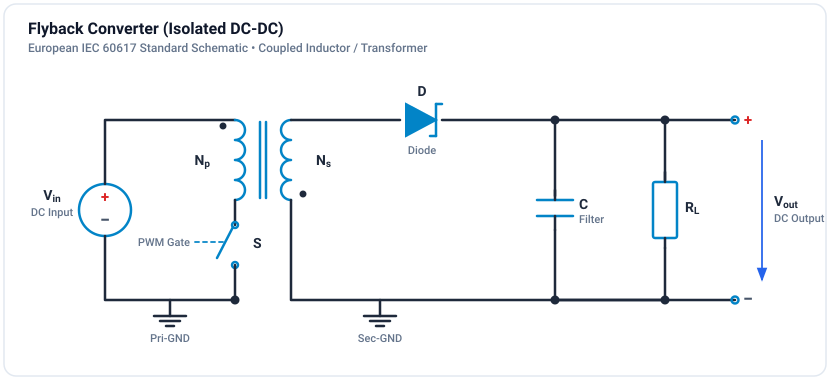

# Tutorial: Flyback Converter

Design and simulate an isolated flyback converter.

**Difficulty:** Intermediate (2/3) | **Duration:** 30 minutes

## Learning Objectives

- [ ] Understand flyback operation and energy transfer
- [ ] Design the coupled inductor (flyback transformer)
- [ ] Handle leakage inductance and voltage spikes
- [ ] Simulate transient and steady-state behavior

## Theory

### Topology

The flyback is an isolated version of the buck-boost converter:

### Operating Principle

**Switch ON:** Energy stores in magnetizing inductance Lm. Secondary diode is reverse-biased.

$$V_{Lm} = V_{in}, \quad \Delta i_{Lm} = \frac{V_{in} \cdot D}{L_m \cdot f_{sw}}$$

**Switch OFF:** Stored energy transfers to secondary through the coupled inductor. Diode conducts.

$$V_{Lm} = -\frac{V_{out}}{n}, \quad n = \frac{N_s}{N_p}$$

### Voltage Conversion

$$V_{out} = n \cdot \frac{D}{1-D} \cdot V_{in}$$

Where n = Ns/Np is the turns ratio.

### Key Design Equations

**Magnetizing inductance:**

$$L_m = \frac{V_{in}^2 \cdot D^2}{2 \cdot P_{out} \cdot f_{sw}}$$

**Turns ratio:**

$$n = \frac{V_{out}}{V_{in}} \cdot \frac{1-D}{D}$$

**Switch voltage stress:**

$$V_{DS,max} = V_{in} + \frac{V_{out}}{n} + V_{spike}$$

## Design Example

### Specifications

| Parameter | Value |
|-----------|-------|
| Input voltage | 48V DC |
| Output voltage | 5V DC |
| Output power | 25W |
| Switching frequency | 100 kHz |
| Max duty cycle | 0.45 |

### Calculations

**Turns ratio:**

$$n = \frac{5}{48} \times \frac{1-0.45}{0.45} = 0.127 \approx 1:8 \text{ (Np:Ns)}$$

**Magnetizing inductance (for CCM):**

$$L_m = \frac{48^2 \times 0.45^2}{2 \times 25 \times 100k} = 93.3\ \mu H$$

**Output capacitor:**

$$C = \frac{I_{out} \cdot D}{f_{sw} \cdot \Delta V_{out}} = \frac{5 \times 0.45}{100k \times 0.05} = 450\ \mu F$$

## Leakage Inductance

Real transformers have imperfect coupling (k < 1). The leakage inductance causes:

- Voltage spikes on the switch at turn-off
- Energy loss if not recovered
- EMI concerns

### Snubber Circuit

An RCD snubber clamps the voltage spike:

$$R_{snub} = \frac{V_{clamp}^2}{P_{leak}}, \quad C_{snub} = \frac{V_{clamp}}{R_{snub} \cdot f_{sw} \cdot \Delta V_{clamp}}$$

## Simulation & Project File

A complete, simulated and verified Isolated Flyback Converter project file is provided directly in this directory:

- **Project File**: [:material-download: flyback-converter.ipes](flyback-converter.ipes)

### Flyback Energy Storage & Coupling Parameters

In GeckoCIRCUITS, the flyback transformer is modeled using coupled inductors with a coupling coefficient:

| Parameter | Value | Description |
| :--- | :--- | :--- |
| **Input Voltage ($V_{in}$)** | 24.0 V DC | Primary DC supply bus |
| **Primary Inductor ($L_p$)** | $100\,\mu\text{H}$ | Magnetizing & primary energy storage |
| **Secondary Inductor ($L_s$)** | $100\,\mu\text{H}$ | Secondary discharge winding (1:1 turns ratio) |
| **Coupling Coefficient ($k$)** | 0.99 | High coupling ($k \to 1.0$) with small leakage |
| **Duty Cycle ($D$)** | 0.35 | 35% duty ratio at 50 kHz ($T_s = 20\,\mu\text{s}$) |
| **Secondary Filter ($C_{out}$)** | $470\,\mu\text{F}$ | Low-ESR secondary output filter |
| **Load Resistance ($R_{load}$)** | $5.0\,\Omega$ | Secondary DC load ($P \approx 25\text{ W}$) |
| **Simulation Step $\Delta t$** | $1.0\,\mu\text{s}$ | Fine temporal resolution |
| **Simulation Duration** | $10.0\,\text{ms}$ | 10,001 time steps (500 switching periods) |

### Monitored Probe Signals

| Signal | Expected Value | Description |
| :--- | :--- | :--- |
| `v_out` | $\approx 11.5\text{ V DC}$ | Isolated secondary output voltage across load |
| `v_sw` | Square pulse with flyback spike | Voltage across the primary switch ($V_{in} + \frac{N_p}{N_s} V_{out} + V_{leak}$) |
| `pwm` | 50 kHz square wave, $35\%$ duty | Primary gate pulse |

### How to Run in GeckoCIRCUITS

1. Open `flyback-converter.ipes` in GeckoCIRCUITS desktop or simulate via MCP `gecko_simulate`.
2. Press **F5** to run the simulation.
3. Open the **Scope** window to inspect:
   - Primary switch voltage rising to $V_{in} + n V_{out}$ during turn-off.
   - Smooth DC output voltage regulation on the secondary side across the isolated load.

## Exercises

### Exercise 1: CCM vs DCM
Reduce the load (increase $R$ to $50\,\Omega$). Observe the magnetizing energy fully discharging before the next switching period begins (DCM).

### Exercise 2: Turns Ratio Scaling
Modify secondary inductance $L_s$ to $25\,\mu\text{H}$ ($n = N_s/N_p = \sqrt{25/100} = 0.5$). Observe the output voltage scaling down proportionally to $\approx 5.5\text{ V}$.

### Exercise 3: Snubber Design
To prevent high voltage spikes when $k$ is reduced to 0.95, place an RCD snubber across the primary winding (diode in series with parallel $R = 1\,\text{k}\Omega$ and $C = 10\,\text{nF}$).

## Next Steps

- [Forward Converter](forward.md) - True transformer isolated step-down topology
- [Thermal Simulation](../../tutorials/thermal/loss-calculation.md) - Add switch and diode losses
- [Magnetics](../../tutorials/magnetics/transformer-design.md) - Detailed transformer design
