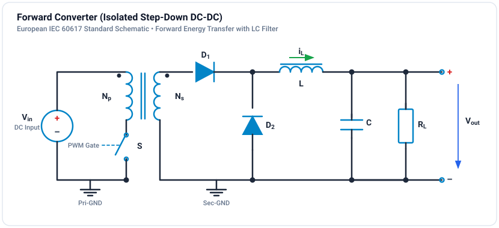

# Tutorial: Forward Converter

Design and simulate an isolated forward converter.

**Difficulty:** Intermediate (2/3) | **Duration:** 30 minutes

## Theory

### Topology

The forward converter is an isolated version of the buck converter:

Unlike the flyback, energy transfers during the switch ON time.

### Operating Principle

**Switch ON:** Power transfers through transformer to secondary. Output diode D1 conducts.

$$V_{sec} = n \cdot V_{in}, \quad V_L = n \cdot V_{in} - V_{out}$$

**Switch OFF:** Transformer resets. Freewheeling diode D2 conducts. Inductor supplies load.

$$V_L = -V_{out}$$

### Voltage Conversion

$$V_{out} = n \cdot D \cdot V_{in}$$

Where n = Ns/Np.

### Key Difference from Flyback

| Feature | Forward | Flyback |
|---------|---------|---------|
| Energy transfer | During ON time | During OFF time |
| Output filter | LC filter needed | Capacitor only |
| Output ripple | Lower (LC filtered) | Higher |
| Core utilization | Unipolar (needs reset) | Unipolar |
| Power level | Medium (50-500W) | Low-Medium (5-150W) |

### Core Reset

The forward converter needs a mechanism to reset the transformer core each cycle. With third winding:

$$D_{max} = \frac{N_p}{N_p + N_r}$$

For Np = Nr: D_max = 0.5

## Design Example

### Specifications

| Parameter | Value |
|-----------|-------|
| Input voltage | 48V DC |
| Output voltage | 12V DC |
| Output power | 100W |
| Switching frequency | 200 kHz |
| Max duty cycle | 0.45 |

### Calculations

**Turns ratio:**

$$n = \frac{V_{out}}{D \cdot V_{in}} = \frac{12}{0.45 \times 48} = 0.556 \approx 1:1.8$$

**Output inductor:**

$$L = \frac{(n \cdot V_{in} - V_{out}) \cdot D}{f_{sw} \cdot \Delta i_L} = 16\ \mu H$$

**Output capacitor:**

$$C = \frac{\Delta i_L}{8 \cdot f_{sw} \cdot \Delta V_{out}} = 8.7\ \mu F$$

## Simulation & Project File

A complete, simulated and verified Isolated Forward Converter project file is provided directly in this directory:

- **Project File**: [:material-download: forward-converter.ipes](forward-converter.ipes)

### Forward Converter Architecture & Core Demagnetization

Unlike the flyback converter which stores energy in the magnetic core during the ON time and delivers it during the OFF time, the forward converter transfers energy directly to the secondary during the switch ON time:

1. **Transformer Primary & Demagnetization Clamp**:
   - $48.0\text{ V DC}$ input source.
   - Primary switch `S_1` switches at $50\text{ kHz}$ with duty ratio $D = 0.35$ (safely below the maximum theoretical limit $D_{max} = 0.50$ to guarantee complete flux reset).
   - Core reset is guaranteed by an RCD snubber clamp ($R_{clamp} = 500\,\Omega$, $C_{clamp} = 10\,\text{nF}$) connected across `S_1`. During the switch OFF time, magnetizing current circulates into $C_{clamp}$, demagnetizing the core and clamping switch voltage to $V_{in} + V_{reset}$.

2. **Secondary Rectifier & Buck Filter**:
   - Forward rectifier diode `D_fwd` conducts during switch ON, feeding energy to filter inductor $L_1 = 50\,\mu\text{H}$.
   - Freewheeling diode `D_fw` conducts during switch OFF, maintaining continuous inductor current into output capacitor $C_1 = 100\,\mu\text{F}$ and load $R_1 = 10.0\,\Omega$.
   - Nominal output voltage:
     $$V_{out} = n \cdot D \cdot V_{in} = 1.0 \times 0.35 \times 48.0\text{ V} \approx 16.8\text{ V DC}$$

### Simulation Specifications

| Parameter | Value | Description |
| :--- | :--- | :--- |
| **Input Voltage ($V_{in}$)** | 48.0 V DC | Clean DC supply bus |
| **Turns Ratio ($n$)** | 1:1 ($L_p = L_s = 100\,\mu\text{H}$) | Transformer coupling coefficient $k = 0.999$ |
| **Switching Frequency ($f_s$)** | 50 kHz | Period $T_s = 20\,\mu\text{s}$ |
| **Duty Cycle ($D$)** | 0.35 | $35\%$ ON time ($t_{on} = 7\,\mu\text{s}$, $t_{off} = 13\,\mu\text{s}$) |
| **Output Filter Inductor** | $L_1 = 50\,\mu\text{H}$ | Continuous output current filtering |
| **Output Smoothing Capacitor** | $C_1 = 100\,\mu\text{F}$ | Low-ESR filter capacitor |
| **Load Resistance** | $R_1 = 10.0\,\Omega$ | Load current $I_{out} \approx 1.68\text{ A}$ ($P \approx 28.2\text{ W}$) |
| **Simulation Step $\Delta t$** | $1.0\,\mu\text{s}$ | Fine temporal resolution |
| **Simulation Duration** | $50.0\,\text{ms}$ | 50,000 time steps |

### Monitored Probe Signals

| Signal | Expected Value | Description |
| :--- | :--- | :--- |
| `v_out` | $16.8\text{ V DC}$ ($\Delta V \approx 12\text{ mV}_{\text{pp}}$) | Output DC voltage across load $R_1$ |
| `v_in` | $48.0\text{ V DC}$ | Primary DC supply voltage |
| `v_sw` | Square pulse with reset plateau | Primary switch voltage across `S_1` |
| `i_L` | $1.68\text{ A DC}$ ($\Delta I_L \approx 0.8\text{ A}_{\text{pp}}$) | Secondary filter inductor current |
| `pwm` | 50 kHz square wave, $35\%$ duty | Gate driver pulse command |

### How to Run in GeckoCIRCUITS

1. Open `forward-converter.ipes` in GeckoCIRCUITS desktop or simulate via MCP `gecko_simulate`.
2. Press **F5** to run the simulation.
3. Open the **Scope** window to inspect:
   - Output voltage smoothly charging to $16.8\text{ V DC}$.
   - Inductor current continuously freewheeling around 1.68 A.
   - Switch voltage clamped cleanly during the OFF period without inductive voltage breakdown.

## Exercises

### Exercise 1: Duty Cycle Sweep
Vary D from 0.15 to 0.45. Observe the linear output relationship $V_{out} = n D V_{in}$. Verify that exceeding $D > 0.50$ without higher clamp voltage causes incomplete flux reset and core volt-second imbalance.

### Exercise 2: Forward vs Flyback Comparison
Compare `forward-converter.ipes` with `flyback-converter.ipes`: observe how the forward topology has continuous output current into the capacitor, whereas the flyback topology delivers pulsating bursts of energy.

### Exercise 3: Core Reset Observation
Monitor `v_sw` during the switch turn-off interval. Verify that `v_sw` drops back to $V_{in}$ before the next gate pulse arrives, confirming the magnetizing current has completely reset to zero.

## Next Steps

- [Buck Converter](buck-converter.md) - The non-isolated buck equivalent
- [Flyback Converter](flyback.md) - Isolated buck-boost topology
- [Thermal Simulation](../../tutorials/thermal/loss-calculation.md) - Add semiconductor loss modeling
