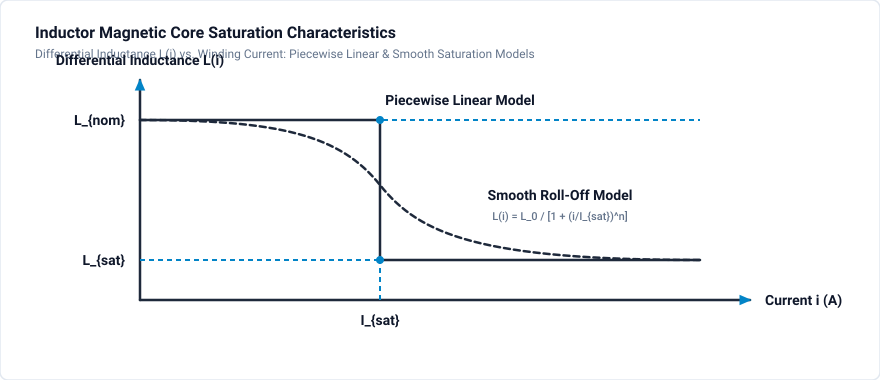

# 903 - Inductor Saturation

Non-linear inductance modeling and saturation effects.

## Overview

Inductor saturation occurs when the core's magnetic flux density approaches Bsat, causing:
- Dramatic inductance drop
- Current spike
- Potential device damage
- Control instability

## Saturation Physics

### B-H Relationship

$$B = \mu_0 \mu_r(H) \cdot H$$

At saturation (core behaves like air):

$$\mu_r \rightarrow 1$$

### Inductance vs Current

$$L(i) = \frac{N^2 \cdot \mu_0 \mu_r(i) \cdot A_e}{l_e}$$

As i increases → H increases → μr decreases → L decreases

## Saturation Models

### Inductance Characteristics



### Piecewise Linear Model

Simple region-based saturation model:

$$
L(i) = \begin{cases} L_{nom} & |i| < I_{sat} \\ L_{sat} & |i| \geq I_{sat} \end{cases}
$$

### Smooth Saturation Model

More realistic continuous saturation roll-off:

$$
L(i) = \frac{L_0}{1 + (i/I_{sat})^n}
$$

Where $n$ controls transition sharpness (typically $2 \dots 6$).

### Jiles-Atherton

Physics-based model including:
- Anhysteretic magnetization
- Domain wall motion
- Energy loss (hysteresis)

## Impact on Converter Operation

### DC-DC Converter

**Normal operation (CCM):**
- Triangle current waveform
- Predictable ripple

**Saturated operation:**
- Current spike during on-time
- Potential switch damage
- EMI increase

### Current at Saturation

$$I_{sat} = \frac{B_{sat} \cdot l_e}{\mu_0 \mu_r \cdot N}$$

With air gap:

$$I_{sat} = \frac{B_{sat} \cdot l_g}{\mu_0 \cdot N}$$

## Design for Saturation Avoidance

### Method 1: Air Gap

Add gap to reduce effective permeability:

$$\mu_{eff} = \frac{\mu_r}{1 + \mu_r \cdot l_g/l_e}$$

Benefits:
- Stores energy in gap
- Soft saturation characteristic
- Stable inductance vs temperature

### Method 2: Larger Core

Increase Ae to reduce B for given flux:

$$B = \frac{L \cdot I_{peak}}{N \cdot A_e}$$

### Method 3: Distributed Gap Materials

Powder cores (Kool Mμ, MPP, etc.):
- Inherent distributed gap
- Soft saturation
- Higher core losses

## Saturation Effects Analysis

### Buck Converter Example

| Parameter | Before Sat | After Sat |
|-----------|------------|-----------|
| Inductance | 100 µH | 10 µH |
| di/dt | 50 A/µs | 500 A/µs |
| Peak current | 10 A | unlimited |

### Transient Response

During load step:
1. Current increases toward new operating point
2. If current exceeds Isat, L drops suddenly
3. di/dt increases dramatically
4. Current overshoots

## GeckoCIRCUITS Saturation Modeling

### Using Non-linear Inductor

1. Select **saturating inductor** component
2. Enter parameters:
   - Nominal inductance L0
   - Saturation current Isat
   - Saturated inductance Lsat
3. Or use flux-linkage characteristic

### Using Magnetic Domain

1. Create permeance with saturation
2. Enter B-H curve data points
3. Connect winding to electrical circuit
4. Observe flux and inductance vs current

## Simulation Project: Linear vs. Saturating Inductor Comparison

The companion project file [`inductor-saturation.ipes`](inductor-saturation.ipes) compares a linear inductor against an authentic non-linear saturating choke driven in parallel by a common voltage step excitation in GeckoCIRCUITS.

### Circuit & Simulation Specifications

| Parameter | Value | Description |
| :--- | :--- | :--- |
| **Circuit File** | [`inductor-saturation.ipes`](inductor-saturation.ipes) | Validated saturation comparison model |
| **Excitation Voltage (`U.1`)** | $40\text{ V DC}$ pulse | Step voltage driving parallel branches |
| **Branch 1 (Linear Inductor)** | `R.1` ($1.0\,\Omega$) + `L.3` ($500\,\mu\text{H}$) | Linear reference choke (`isNonlinear false`) |
| **Branch 2 (Saturating Inductor)** | `R.3` ($1.0\,\Omega$) + `L.4` (Non-linear) | Saturating power choke (`isNonlinear true`) |
| **Saturation Characteristic (`L.4`)** | $0\text{ A} \to 500\,\mu\text{H}$, $7\text{ A} \to 500\,\mu\text{H}$, $10\text{ A} \to 150\,\mu\text{H}$, $30\text{ A} \to 100\,\mu\text{H}$ | Non-linear inductance vs. current lookup curve |
| **Saturation Knee ($I_{sat}$)** | $7.0\text{ A}$ | Transition current where core enters saturation |
| **Simulation Step ($\Delta t$)** | $1.0\,\mu\text{s}$ | High temporal resolution |
| **Simulation Duration** | $0.005\text{ s}$ ($5\text{ ms}$) | Complete current transient through saturation knee |

### Current Slope Acceleration Physics

For the linear inductor `L.3`, the current rises monotonically according to:

$$
i_{linear}(t) = \frac{V}{R} \left(1 - e^{-t/\tau}\right), \quad \tau = \frac{L_0}{R} = \frac{500\,\mu\text{H}}{1\,\Omega} = 500\,\mu\text{s}
$$

For the saturating inductor `L.4`:
- When $i < 7.0\text{ A}$: $L(i) = 500\,\mu\text{H}$, and the current slope matches the linear choke: $\frac{di}{dt} = \frac{V - R i}{500\,\mu\text{H}}$.
- When $i > 7.0\text{ A}$: The core saturates, and inductance drops to $100\,\mu\text{H}$. The current slope surges by a factor of 5:

$$
\left.\frac{di}{dt}\right|_{sat} = \frac{V - R i}{100\,\mu\text{H}} \approx 5 \times \left.\frac{di}{dt}\right|_{unsaturated}
$$

This causes a sharp upward curvature in the current waveform, demonstrating the severe current spikes caused by core saturation.

### How to Run Simulation

=== "GeckoCIRCUITS GUI"
    1. Open `inductor-saturation.ipes` in GeckoCIRCUITS desktop.
    2. Click **Start Simulation** (or press **F5**).
    3. Open the **Scope** window and overlay the currents of `L.3` and `L.4` to observe the sharp divergence beyond $7.0\text{ A}$.

=== "MCP Interface (Command Line)"
    ```bash
    # Validate circuit integrity
    python -c "from scripts.desktop.mcp_client import GeckoMcpClient; c = GeckoMcpClient(); c.start(); print(c.call_tool('gecko_validate_circuit', {'circuit_path': 'docs/tutorials/magnetics/inductor-saturation.ipes'})); c.close()"

    # Run simulation
    python -c "from scripts.desktop.mcp_client import GeckoMcpClient; c = GeckoMcpClient(); c.start(); print(c.call_tool('gecko_simulate', {'circuit_path': 'docs/tutorials/magnetics/inductor-saturation.ipes', 'total_time': 0.005, 'time_step': 1e-6})); c.close()"
    ```

## Simulation Exercises

1. Observe the current waveform bifurcation point at $i = 7\text{ A}$ ($t \approx 0.1\text{ ms}$).
2. Modify the excitation voltage from $40\text{ V}$ to $20\text{ V}$ and observe whether current reaches the saturation threshold during the pulse.
3. Edit the saturation curve in `L.4` to model a distributed air-gap powder core (smoother roll-off) vs an ungapped ferrite core (abrupt drop).
4. Calculate peak switch stress and peak dissipated energy in both branches.

## Design Guidelines

### Maximum Flux Density

| Core Material | Bsat (T) | Typical Use |
|---------------|----------|-------------|
| Ferrite (N87) | 0.39 | High frequency SMPS |
| Ferrite (N49) | 0.49 | High Bsat resonant converters |
| Kool Mμ | 1.0 | DC bias PFC chokes |
| Iron powder | 1.0-1.4 | Low-cost DC filtering |
| Nanocrystalline | 1.2 | High performance common-mode chokes |

### Safety Margin

Design for:

$$I_{peak} \leq 0.8 \cdot I_{sat}$$

Account for:
- Load transients and startup inrush currents
- High temperature degradation ($B_{sat}$ drops by $20\dots 30\%$ at $100^\circ\text{C}$)
- Component manufacturing tolerance ($\pm 15\%$)

## Related Resources

- [901 - Magnetic Domain](magnetic-domain.md) — Permeance-capacitance analog modeling
- [902 - Transformer Design](transformer-design.md) — High-frequency transformer design and leakage
- [Buck Converter Tutorial](../dcdc/buck-converter.md) — DC-DC inductor design in CCM

