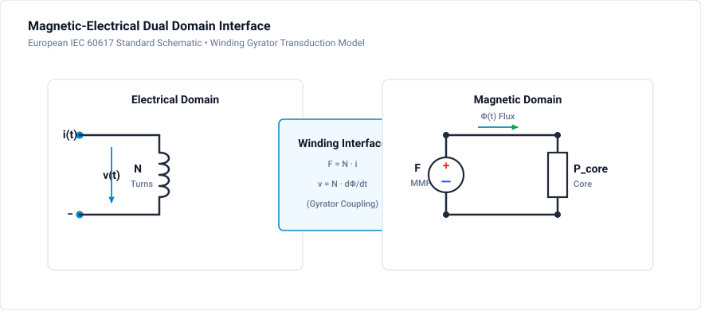

# 901 - Magnetic Domain

Permeance-capacitance modeling for magnetic circuits.

## Overview

GeckoCIRCUITS uses the **permeance-capacitance analogy** for magnetic circuit simulation, enabling:
- Core saturation modeling
- Leakage inductance effects
- Coupled inductors and transformers
- Non-linear magnetic behavior

## Magnetic-Electrical Analogy

### Permeance-Capacitance Model

| Magnetic | Electrical | Unit |
|----------|------------|------|
| MMF (F) | Voltage (V) | A-turns / V |
| Flux (Φ) | Charge (Q) | Wb / C |
| dΦ/dt | Current (I) | V / A |
| Permeance (P) | Capacitance (C) | H / F |
| Reluctance (R) | 1/C | 1/H / 1/F |

### Why This Analogy?

The permeance-capacitance model:
- Allows integration with electrical circuit
- Handles non-linear permeability naturally
- Supports multiple windings on single core
- Models leakage paths explicitly

## Basic Components

### Permeance (Magnetic Capacitor)

$$P = \frac{\mu_0 \mu_r A}{l}$$

Where:
- μ₀ = 4π × 10⁻⁷ H/m
- μᵣ = relative permeability
- A = cross-sectional area
- l = magnetic path length

### Winding (Gyrator)

Converts electrical current to MMF:

$$
F = N \cdot i
$$

$$
v = N \cdot \frac{d\Phi}{dt}
$$

### Air Gap

$$
P_{gap} = \frac{\mu_0 A_{eff}}{l_g}
$$

With fringing factor for accurate modeling.

## Building Magnetic Circuits

### Winding-to-Core Dual Domain Interface



The dual-domain interface models:
- **Electrical Port:** Winding with $N$ turns, terminal voltage $v(t)$, and current $i(t)$.
- **Magnetic Port:** Magnetomotive force $F = N \cdot i$, driving core flux $\Phi$ through core permeance $P_{core}$ and air gap permeance $P_{gap}$.
- **Coupling Principle:** The rate of change of magnetic flux induces back-EMF according to Faraday's law $v = N \cdot \frac{d\Phi}{dt}$.

## Saturation Modeling

### B-H Curve

Non-linear permeability:

$$
B = f(H) = \mu_0 \mu_r(H) \cdot H
$$

### Jiles-Atherton Model

Physics-based hysteresis model with parameters:
- Ms = saturation magnetization
- a = domain wall density
- k = pinning coefficient
- c = reversibility
- α = domain coupling

### Piecewise Linear

Simpler approach with:
- Initial permeability μᵢ
- Saturation flux Bsat
- Saturated permeability μsat ≈ μ₀

## Core Loss Modeling

### Steinmetz Equation

$$P_v = k \cdot f^\alpha \cdot B^\beta$$

Typical values:
- Ferrite: α ≈ 1.3, β ≈ 2.5
- Iron powder: α ≈ 1.5, β ≈ 2.0

### Improved GSE (iGSE)

For non-sinusoidal waveforms:

$$P_v = \frac{1}{T}\int_0^T k_i \left|\frac{dB}{dt}\right|^\alpha (\Delta B)^{\beta-\alpha} dt$$

## GeckoCIRCUITS Setup

### Creating Magnetic Components

1. **Add permeance element** from magnetic component library
2. **Set core parameters:**
   - Material (ferrite, iron powder)
   - Dimensions (A, l)
   - Saturation characteristics
3. **Add windings** and connect to electrical circuit
4. **Add leakage permeance** if needed

### Material Database

GeckoCIRCUITS includes common materials:
- N87, N97, N49 (ferrite)
- Kool Mμ, MPP (powder core)
- Nanocrystalline

## Simulation Project: Coupled Magnetic Windings & Permeance Network

The companion project file [`magnetic-domain.ipes`](magnetic-domain.ipes) demonstrates the permeance-capacitance dual-domain coupling and magnetic inductor interaction in GeckoCIRCUITS.

### Circuit & Simulation Specifications

| Parameter | Value | Description |
| :--- | :--- | :--- |
| **Circuit File** | [`magnetic-domain.ipes`](magnetic-domain.ipes) | Validated coupled magnetic project |
| **AC Source ($V_{ac}$)** | $230\text{ V RMS}$ ($327\text{ V peak}$), $50\text{ Hz}$ | Grid excitation source (`U.1`) |
| **Primary Resistance ($R_1$)** | $1.0\,\Omega$ | Primary winding resistance |
| **Primary Inductor ($L_{c1}$)** | $5.0\text{ mH}$ | Primary coupled magnetic winding (`Lc.1`) |
| **Secondary Inductors ($L_{c2}, L_{c3}$)** | $2.0\text{ mH}$ each | Center-tapped secondary magnetic windings (`Lc.2`, `Lc.3`) |
| **Magnetic Couplers ($K_1, K_2, K_3$)** | $k = 0.98$ | Core magnetic permeance coupling factors (`typ 9`) |
| **Rectification Stage** | 2 power diodes (`D.1`, `D.2`) | Converts AC flux induced voltages into DC |
| **DC Load Resistor ($R_2$)** | $0.2\,\Omega$ | High-current DC secondary load |
| **Filter Capacitor ($C_1$)** | $10\text{ nF}$ | Secondary snubber/filter |
| **Simulation Step ($\Delta t$)** | $1.0\,\mu\text{s}$ | Fast MNA solver step |
| **Simulation Duration** | $0.04\text{ s}$ ($40\text{ ms}$) | Two full AC line cycles (40,001 time steps) |

### Magnetic Coupling Physics

The coupling factor $k$ between windings $L_1$ and $L_2$ defines the mutual inductance:

$$
M = k \sqrt{L_1 L_2} = 0.98 \sqrt{5.0\text{ mH} \cdot 2.0\text{ mH}} = 3.10\text{ mH}
$$

The leakage inductance referred to the primary is:

$$
L_{\sigma} = (1 - k^2) L_1 = (1 - 0.98^2) \cdot 5.0\text{ mH} \approx 0.198\text{ mH}
$$

### How to Run Simulation

=== "GeckoCIRCUITS GUI"
    1. Open `magnetic-domain.ipes` in GeckoCIRCUITS desktop.
    2. Click **Start Simulation** (or press **F5**).
    3. Open the **Scope** window and observe primary and secondary induced voltages and current sharing.

=== "MCP Interface (Command Line)"
    ```bash
    # Validate circuit integrity
    python -c "from scripts.desktop.mcp_client import GeckoMcpClient; c = GeckoMcpClient(); c.start(); print(c.call_tool('gecko_validate_circuit', {'circuit_path': 'docs/tutorials/magnetics/magnetic-domain.ipes'})); c.close()"

    # Run simulation
    python -c "from scripts.desktop.mcp_client import GeckoMcpClient; c = GeckoMcpClient(); c.start(); print(c.call_tool('gecko_simulate', {'circuit_path': 'docs/tutorials/magnetics/magnetic-domain.ipes', 'total_time': 0.04, 'time_step': 1e-6})); c.close()"
    ```

## Simulation Exercises

1. Measure induced secondary voltage with coupling factor $k = 0.98$ vs $k = 0.80$ to observe voltage regulation degradation due to leakage flux.
2. Calculate the mutual inductance $M$ from measured open-circuit voltage transfer ratio $V_2 / V_1$.
3. Observe the phase relationship between primary magnetizing current and secondary load current.
4. Correlate winding copper losses with primary and secondary RMS currents.

## Related Resources

- [902 - Transformer Design](transformer-design.md) — Practical transformer equivalent circuits, parasitics, and leakage
- [903 - Inductor Saturation](inductor-saturation.md) — Non-linear core saturation and current spikes
- [Flyback Converter Tutorial](../dcdc/flyback.md) — Coupled inductor energy storage

