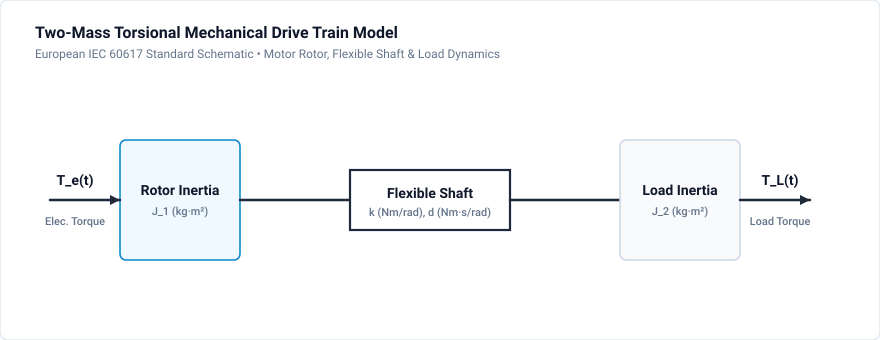

# 904 - Mechanical Systems

Motor-load dynamics and electromechanical simulation.

## Overview

Power electronics often drive mechanical loads through electric machines. GeckoCIRCUITS supports:
- Rotating machine models (PMSM, BLDC, IM)
- Mechanical load models
- Multi-mass systems
- Gear boxes and couplings

## Mechanical-Electrical Analogy

### Force/Torque Analogy

| Mechanical (Rotational) | Electrical | Unit |
|------------------------|------------|------|
| Torque τ | Voltage V | Nm / V |
| Angular velocity ω | Current I | rad/s / A |
| Inertia J | Capacitance C | kg·m² / F |
| Friction b | Conductance G | Nm·s / S |
| Stiffness k | 1/L | Nm/rad / 1/H |

## Basic Mechanical Models

### Single Inertia

$$J \frac{d\omega}{dt} = \tau_{motor} - \tau_{load} - b\omega$$

In GeckoCIRCUITS: Capacitor with value J

### Two-Mass System

Models shaft compliance:



Equations:

$$J_1 \frac{d\omega_1}{dt} = \tau_m - \tau_s$$

$$J_2 \frac{d\omega_2}{dt} = \tau_s - \tau_L$$

$$\tau_s = k(\theta_1 - \theta_2) + b(\omega_1 - \omega_2)$$

## Load Types

### Constant Torque

$$\tau_L = \tau_0$$

Applications: Conveyors, hoists, cranes

### Quadratic (Fan/Pump)

$$\tau_L = k \cdot \omega^2$$

Applications: Fans, pumps, blowers

### Linear (Friction)

$$\tau_L = b \cdot \omega$$

Viscous friction model

### Constant Power

$$\tau_L = \frac{P_0}{\omega}$$

Applications: Winders, machine tools

## Motor Models

### PMSM (Permanent Magnet Synchronous Motor)

**Electrical equations (dq frame):**

$$v_d = R_s i_d + L_d \frac{di_d}{dt} - \omega_e L_q i_q$$

$$v_q = R_s i_q + L_q \frac{di_q}{dt} + \omega_e L_d i_d + \omega_e \psi_m$$

**Torque:**

$$\tau_e = \frac{3}{2} p [\psi_m i_q + (L_d - L_q)i_d i_q]$$

### BLDC (Brushless DC)

Trapezoidal back-EMF model:

$$e_{ph} = k_e \cdot \omega \cdot f(\theta_e)$$

Where f(θe) is trapezoidal function of electrical angle.

### Induction Motor

**Rotor flux model:**

$$\frac{d\psi_r}{dt} = \frac{L_m}{\tau_r}i_s - \frac{1}{\tau_r}\psi_r + j\omega_{slip}\psi_r$$

**Torque:**

$$\tau_e = \frac{3}{2}p\frac{L_m}{L_r}Im\{\psi_r^* i_s\}$$

## Gearbox Modeling

### Ideal Gear Ratio

$$\omega_2 = \frac{\omega_1}{n}$$

$$\tau_2 = n \cdot \tau_1$$

### Reflected Inertia

$$J_{eq} = J_1 + \frac{J_2}{n^2}$$

Inertia seen from motor side

### Gear Efficiency

$$\tau_2 = \eta \cdot n \cdot \tau_1 \quad \text{(motoring)}$$

$$\tau_2 = \frac{n \cdot \tau_1}{\eta} \quad \text{(regenerating)}$$

## GeckoCIRCUITS Setup

### Adding Mechanical Domain

1. **Insert motor model** from component library
2. **Set parameters:**
   - Electrical: Rs, Ld, Lq, ψm
   - Mechanical: J (motor inertia), b (friction)
   - Pole pairs p
3. **Add load model:**
   - Connect mechanical port to load
   - Set load type and parameters

### Multi-Mass Systems

1. **Use mechanical nodes** (angular velocity)
2. **Connect:**
   - Inertia elements (capacitors)
   - Shaft compliance (spring-damper)
   - Gearbox (transformer)

## Simulation Project: Two-Mass Electromechanical Drivetrain

The companion project file [`mechanical-systems.ipes`](mechanical-systems.ipes) models a compliant two-mass rotational drivetrain in GeckoCIRCUITS, simulating torsional oscillations, shaft compliance, and speed response under step torque excitation.

### Circuit & Simulation Specifications

| Parameter | Mechanical Value | Electrical Analogy | Description |
| :--- | :--- | :--- | :--- |
| **Circuit File** | [`mechanical-systems.ipes`](mechanical-systems.ipes) | Validated electromechanical model | Complete simulation project |
| **Motor Drive Torque ($\tau_m$)** | $50.0\text{ Nm}$ | $V_{drive} = 50.0\text{ V}$ (`TAU_M`) | Step motor torque |
| **Internal Source Resistance** | $0.5\text{ Nm}\cdot\text{s/rad}$ | $R_{int} = 0.5\,\Omega$ (`R_INT`) | Motor torque generation compliance |
| **Motor Rotor Inertia ($J_1$)** | $0.05\text{ kg}\cdot\text{m}^2$ | $C_1 = 0.05\text{ F}$ (`J1_MOTOR`) | Motor rotor mass |
| **Shaft Torsional Stiffness ($k$)** | $1000.0\text{ Nm/rad}$ | $L_{shaft} = 1.0\text{ mH}$ (`K_SHAFT`) | Elastic shaft compliance ($1/k$) |
| **Shaft Damping ($b_s$)** | $0.1\text{ Nm}\cdot\text{s/rad}$ | $R_{shaft} = 10.0\,\Omega$ (`B_SHAFT`) | Torsional internal damping |
| **Load Inertia ($J_2$)** | $0.15\text{ kg}\cdot\text{m}^2$ | $C_2 = 0.15\text{ F}$ (`J2_LOAD`) | Driven machine inertia |
| **Load Viscous Friction ($b_L$)** | $0.2\text{ Nm}\cdot\text{s/rad}$ | $R_{load} = 5.0\,\Omega$ (`B_LOAD`) | Load resistance ($1/b_L$) |
| **Simulation Step ($\Delta t$)** | $10.0\,\mu\text{s}$ | Fast MNA solver step | 15,001 time steps |
| **Simulation Duration** | $0.15\text{ s}$ ($150\text{ ms}$) | Captures startup transient and torsional settling |

### Torsional Resonance Frequency

The mechanical natural resonance frequency of the two-mass system is:

$$
f_{res} = \frac{1}{2\pi}\sqrt{\frac{k(J_1 + J_2)}{J_1 J_2}} = \frac{1}{2\pi}\sqrt{\frac{1000 \cdot (0.05 + 0.15)}{0.05 \cdot 0.15}} = \frac{1}{2\pi}\sqrt{26666.7} \approx 25.99\text{ Hz}
$$

During acceleration, motor angular velocity $\omega_{motor}$ and load angular velocity $\omega_{load}$ oscillate out-of-phase at $26\text{ Hz}$ before damping out into synchronized steady-state velocity:

$$
\omega_{ss} = \frac{\tau_m}{b_L + b_{int}} = \frac{50.0}{0.2 + 0.5} \approx 71.4\text{ rad/s} \quad (682\text{ RPM})
$$

### Monitored Probe Signals

| Signal | Analogous Unit | Description |
| :--- | :--- | :--- |
| `omega_motor` | $\text{rad/s}$ (Volts) | Motor rotor angular velocity $\omega_1(t)$ |
| `omega_load` | $\text{rad/s}$ (Volts) | Driven load angular velocity $\omega_2(t)$ |

### How to Run Simulation

=== "GeckoCIRCUITS GUI"
    1. Open `mechanical-systems.ipes` in GeckoCIRCUITS desktop.
    2. Click **Start Simulation** (or press **F5**).
    3. Open the **Scope** window and inspect `omega_motor` and `omega_load` to observe the $26\text{ Hz}$ torsional ringing during startup.

=== "MCP Interface (Command Line)"
    ```bash
    # Validate circuit integrity
    python -c "from scripts.desktop.mcp_client import GeckoMcpClient; c = GeckoMcpClient(); c.start(); print(c.call_tool('gecko_validate_circuit', {'circuit_path': 'docs/tutorials/magnetics/mechanical-systems.ipes'})); c.close()"

    # Run simulation
    python -c "from scripts.desktop.mcp_client import GeckoMcpClient; c = GeckoMcpClient(); c.start(); print(c.call_tool('gecko_simulate', {'circuit_path': 'docs/tutorials/magnetics/mechanical-systems.ipes', 'total_time': 0.15, 'time_step': 1e-5})); c.close()"
    ```

## Simulation Exercises

1. Measure the measured oscillation period between velocity peaks and verify $T_{res} \approx 1 / 26\text{ Hz} \approx 38.5\text{ ms}$.
2. Increase shaft stiffness $k$ by $4\times$ ($L_{shaft} = 250\,\mu\text{H}$) and observe how $f_{res}$ doubles to $52\text{ Hz}$.
3. Vary the inertia ratio $\sigma = J_{load} / J_{motor}$ from $3.0$ to $10.0$ and observe the increasing overshoot and settling time.
4. Add a notch filter in the speed controller tuned to $f_{res}$ to suppress mechanical resonance excitation.

## Related Resources

- [901 - Magnetic Domain](magnetic-domain.md) — Magnetic domain modeling
- [902 - Transformer Design](transformer-design.md) — Transformer modeling and parasitics
- [PMSM FOC Example](../../examples/motor-drives/pmsm-foc.md) — Field-Oriented Control of electric machines

