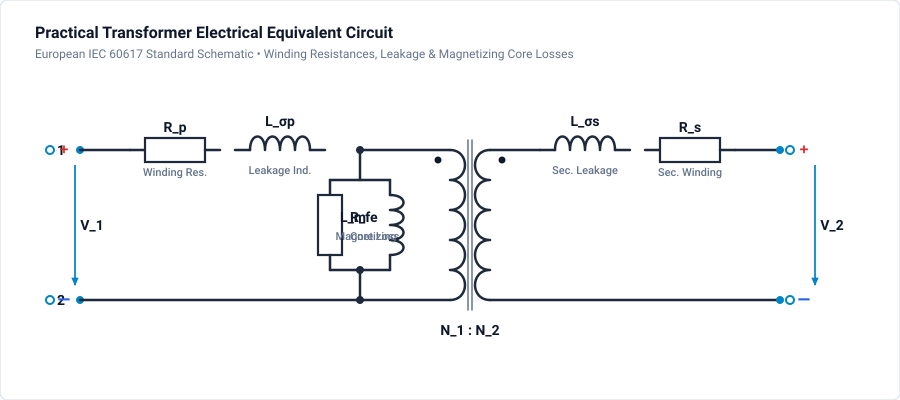
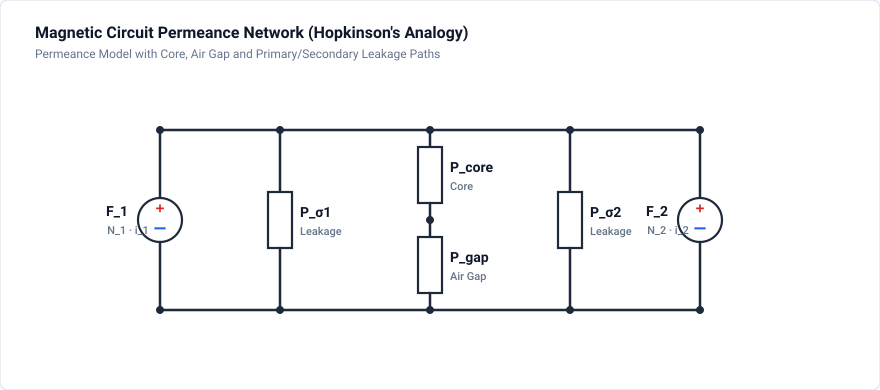

# 902 - Transformer Design

High-frequency transformer modeling with leakage and parasitics.

## Overview

Transformer modeling in power electronics requires:
- Magnetizing inductance
- Leakage inductance
- Winding capacitance
- Core losses

## Transformer Equivalent Circuits

### Ideal Transformer

$$\frac{V_1}{V_2} = \frac{N_1}{N_2} = n$$

$$\frac{I_1}{I_2} = \frac{N_2}{N_1} = \frac{1}{n}$$

### Practical Model



Where:
- $L_m$ = magnetizing inductance
- $R_{fe}$ = core loss equivalent resistance
- $L_{\sigma p}, L_{\sigma s}$ = primary and secondary leakage inductances
- $R_p, R_s$ = primary and secondary winding resistances

## Magnetic Circuit Model

### Permeance Network



### Parameter Extraction

**Magnetizing Inductance:**

$$
L_m = N_1^2 \cdot P_{core}
$$

**Leakage Inductance:**

$$
L_{lk} = N^2 \cdot P_{leak}
$$

## Design Procedure

### Step 1: Core Selection

Area product method:

$$
A_p = A_e \cdot A_w = \frac{P_{out}}{K_f \cdot K_u \cdot J \cdot B_{max} \cdot f}
$$

Where:
- $A_e$ = core cross-section
- $A_w$ = window area
- $K_f$ = waveform factor
- $K_u$ = window utilization
- $J$ = current density
- $B_{max}$ = peak flux density

### Step 2: Turns Calculation

**Primary Turns:**

$$
N_1 = \frac{V_1}{4 \cdot f \cdot B_{max} \cdot A_e}
$$

**Secondary Turns:**

$$
N_2 = \frac{N_1}{n}
$$

### Step 3: Wire Selection

Current density (typical 3-5 A/mm² for natural cooling):

$$
A_{wire} = \frac{I_{rms}}{J}
$$

Skin depth at frequency $f$:

$$
\delta = \sqrt{\frac{\rho}{\pi f \mu}}
$$

### Step 4: Leakage Inductance

Depends on winding arrangement:
- Interleaved: lower leakage
- Separated: higher leakage

$$
L_{lk} \approx \frac{\mu_0 N^2 MLT}{3 h_w} \cdot \left(n_p \cdot b_p + \frac{n_i \cdot b_i}{3}\right)
$$

## Winding Arrangements

### Primary-Secondary (P-S)
- Simple construction
- High leakage inductance
- Suitable for flyback

### Interleaved (P-S-P-S)
- Reduced leakage
- Lower proximity effect
- More complex

### Sandwich (P-S-P)
- Moderate leakage
- Good balance

## Parasitic Capacitances

### Inter-winding Capacitance

$$
C_{ps} = \frac{\epsilon_0 \epsilon_r A_{overlap}}{d_{insulation}}
$$

Important for:
- Common-mode noise
- High dv/dt applications

### Intra-winding Capacitance

Affects self-resonance frequency:

$$
f_{res} = \frac{1}{2\pi\sqrt{L_{lk} C_{self}}}
$$

## GeckoCIRCUITS Transformer Model

### Setting Up

1. Use **coupled inductor** component
2. Set:
   - Turns ratio
   - Magnetizing inductance
   - Leakage inductance (referred to primary)
   - Winding resistances
3. For detailed analysis:
   - Use permeance network
   - Add saturation to core permeance

## Simulation Project: Practical Transformer Equivalent Circuit

The companion project file [`transformer-design.ipes`](transformer-design.ipes) models the practical transformer equivalent circuit in GeckoCIRCUITS, incorporating primary/secondary leakage inductances, copper winding resistances, core magnetizing inductance, and shunt core loss resistance.

### Circuit & Simulation Specifications

| Parameter | Value | Description |
| :--- | :--- | :--- |
| **Circuit File** | [`transformer-design.ipes`](transformer-design.ipes) | Validated practical transformer model |
| **Primary Voltage ($V_{pri}$)** | $230\text{ V RMS}$ ($325.27\text{ V peak}$), $50\text{ Hz}$ | Grid AC voltage source (`V_AC`) |
| **Turns Ratio ($N_1 : N_2$)** | $10.0 : 2.5$ ($4:1$ step-down) | Ideal 4-terminal transformer core (`XFMR`) |
| **Primary Resistance ($R_p$)** | $0.5\,\Omega$ | Primary copper resistance (`R_P`) |
| **Primary Leakage ($L_{\sigma p}$)** | $50.0\,\mu\text{H}$ | Primary leakage inductance (`L_SIGMA_P`) |
| **Magnetizing Inductance ($L_m$)** | $50.0\text{ mH}$ | Core magnetizing inductance (`L_M`) |
| **Core Loss Resistance ($R_{fe}$)** | $10.0\,\text{k}\Omega$ | Eddy current and hysteresis core loss equivalent (`R_FE`) |
| **Secondary Leakage ($L_{\sigma s}$)** | $3.125\,\mu\text{H}$ | Secondary leakage inductance ($L_{\sigma p} / n^2$) (`L_SIGMA_S`) |
| **Secondary Resistance ($R_s$)** | $0.03125\,\Omega$ | Secondary copper resistance ($R_p / n^2$) (`R_S`) |
| **Secondary Load ($R_{load}$)** | $5.0\,\Omega$ | Secondary resistive load (`R_LOAD`) |
| **Simulation Step ($\Delta t$)** | $1.0\,\mu\text{s}$ | Fine temporal resolution |
| **Simulation Duration** | $0.04\text{ s}$ ($40\text{ ms}$) | Two complete $50\text{ Hz}$ line periods (40,001 time steps) |

### Voltage Transfer & Regulation Analysis

For an ideal transformer, the secondary voltage would be:

$$
V_{sec,ideal} = \frac{V_{pri}}{n} = \frac{230\text{ V}}{4} = 57.5\text{ V RMS} \quad (81.32\text{ V peak})
$$

Under loaded conditions ($R_{load} = 5\,\Omega$), the secondary current reflects back to the primary, causing internal voltage drops across the primary impedance $Z_p = R_p + j\omega L_{\sigma p}$ and secondary impedance $Z_s = R_s + j\omega L_{\sigma s}$. At $50\text{ Hz}$, the leakage reactances are negligible compared to load resistances, so voltage regulation is dominated by the copper winding resistances:

$$
R_{eq,sec} = R_s + \frac{R_p}{n^2} = 0.03125\,\Omega + \frac{0.5\,\Omega}{16} = 0.0625\,\Omega
$$

$$
V_{sec,loaded} \approx V_{sec,ideal} \cdot \frac{R_{load}}{R_{load} + R_{eq,sec}} = 57.5\text{ V} \cdot \frac{5.0}{5.0625} \approx 56.79\text{ V RMS} \quad (80.3\text{ V peak})
$$

### Monitored Probe Signals

| Signal | Description | Expected Value |
| :--- | :--- | :--- |
| `v_pri` | Primary AC voltage across supply | $325.27\text{ V peak}$, $50\text{ Hz}$ sinusoidal |
| `v_sec` | Secondary voltage across $R_{load}$ | $\approx 80.3\text{ V peak}$, in-phase with primary |

### How to Run Simulation

=== "GeckoCIRCUITS GUI"
    1. Open `transformer-design.ipes` in GeckoCIRCUITS desktop.
    2. Click **Start Simulation** (or press **F5**).
    3. Open the **Scope** window and inspect `v_pri` and `v_sec` to verify the $4:1$ step-down transformation and voltage regulation.

=== "MCP Interface (Command Line)"
    ```bash
    # Validate circuit integrity
    python -c "from scripts.desktop.mcp_client import GeckoMcpClient; c = GeckoMcpClient(); c.start(); print(c.call_tool('gecko_validate_circuit', {'circuit_path': 'docs/tutorials/magnetics/transformer-design.ipes'})); c.close()"

    # Run simulation
    python -c "from scripts.desktop.mcp_client import GeckoMcpClient; c = GeckoMcpClient(); c.start(); print(c.call_tool('gecko_simulate', {'circuit_path': 'docs/tutorials/magnetics/transformer-design.ipes', 'total_time': 0.04, 'time_step': 1e-6})); c.close()"
    ```

## Simulation Exercises

1. Measure no-load magnetizing current by setting $R_{load} = 1\text{ M}\Omega$. Verify that $I_{mag} \approx V_{pri} / (\omega L_m) = 230 / (2\pi \cdot 50 \cdot 0.05) \approx 14.6\text{ mA RMS}$.
2. Increase primary and secondary leakage inductances by $10\times$ ($L_{\sigma p} = 500\,\mu\text{H}$) and operate at $10\text{ kHz}$. Observe the inductive phase lag and voltage regulation drop.
3. Compare the practical model with an ideal transformer without parasitics.
4. Calculate core power loss: $P_{fe} = V_{pri}^2 / R_{fe} = 230^2 / 10000 = 5.29\text{ W}$.

## Related Resources

- [901 - Magnetic Domain](magnetic-domain.md) — Permeance-capacitance modeling and coupling
- [903 - Inductor Saturation](inductor-saturation.md) — Core saturation and non-linear inductance
- [Flyback Example](../../examples/basic/flyback.md) — Isolated DC-DC converter transformer

