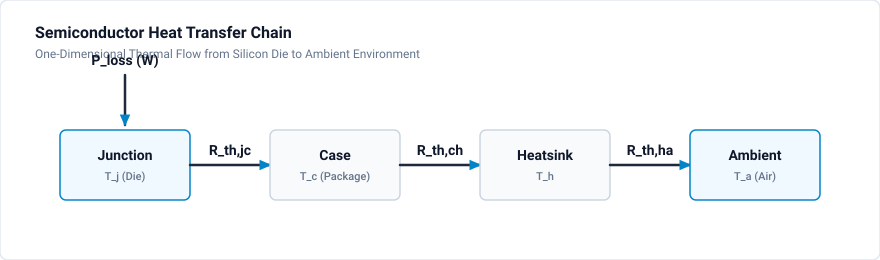

# Thermal Simulation

Power semiconductor loss calculation and thermal modeling for reliable converter design in GeckoCIRCUITS.

## Available Tutorials and Project Files

| Tutorial | Title | Difficulty | Validated Circuit File | Description |
|:---|:---|:---|:---|:---|
| [501](loss-calculation.md) | [Loss Calculation](loss-calculation.md) | Intermediate | [`loss-calculation.ipes`](loss-calculation.ipes) | Buck-boost converter with semiconductor conduction & switching loss models |
| [502](junction-temperature.md) | [Junction Temperature](junction-temperature.md) | Advanced | [`junction-temperature.ipes`](junction-temperature.ipes) | 10 kW Three-Phase VSR with dynamic Cauer/Foster thermal impedance network |
| [503](heatsink-design.md) | [Heatsink Design](heatsink-design.md) | Advanced | [`heatsink-design.ipes`](heatsink-design.ipes) | Power stage thermal budgeting, heatsink selection ($R_{th,ha} = 0.8\text{ K/W}$), and cooling |

## Learning Objectives

- Calculate conduction and switching losses in IGBTs, MOSFETs, and diodes
- Model thermal impedance networks (Foster and Cauer representations)
- Simulate transient and steady-state semiconductor junction temperatures
- Size heatsinks for natural and forced-air convection cooling
- Inspect thermal waveforms and loss metrics via GeckoCIRCUITS GUI and MCP tools

## Quick Reference

### Thermal Resistance Chain

$$
T_j = T_a + P_{loss} \cdot (R_{th,jc} + R_{th,ch} + R_{th,ha})
$$

### Loss Equations

**Conduction Loss:**
- IGBT: $P_{cond} = V_{ce0} \cdot I_c + R_{on} \cdot I_c^2$
- Diode: $P_{cond} = V_f \cdot I_d + R_d \cdot I_d^2$

**Switching Loss:**

$$
P_{sw} = (E_{on} + E_{off}) \cdot f_{sw} \cdot \left(\frac{V_{dc}}{V_{ref}}\right) \cdot \left(\frac{I_c}{I_{ref}}\right)
$$

## Related Resources

- [DC-DC Converter Tutorials](../dcdc/index.md)
- [DC-AC Inverter Tutorials](../dcac/index.md)
- [Analysis Tools in Getting Started](../../getting-started/analysis-tools.md)
