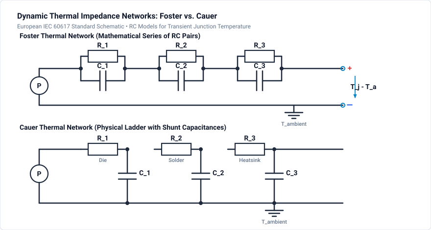

# 502 - Junction Temperature

Thermal network modeling and transient analysis.

## Overview

Junction temperature directly affects:
- Semiconductor reliability (Arrhenius law)
- Conduction losses (RDS(on) increases)
- Switching characteristics
- Safe Operating Area (SOA)

## Thermal Equivalent Circuit

### Electrical-Thermal Analogy

| Thermal | Electrical | Unit |
|---------|------------|------|
| Temperature T | Voltage V | °C / V |
| Heat Flow P | Current I | W / A |
| Thermal Resistance Rth | Resistance R | K/W / Ω |
| Thermal Capacitance Cth | Capacitance C | J/K / F |

### Thermal Network Representation



## Thermal Network Models

### Foster Network

- Series connection of parallel $R_i \parallel C_i$ branches
- Parameters obtained directly from datasheet transient thermal impedance curve fitting
- **Cannot be cascaded** directly (internal nodes have no physical temperature meaning)
- Mathematically efficient for fast simulation

### Cauer Network

- Ladder network with series thermal resistances and shunt thermal capacitances to ambient ground
- Physically meaningful nodes corresponding to semiconductor material layers (junction, silicon die, solder, copper baseplate, heatsink, ambient)
- **Can be cascaded** modularly (junction $\to$ case $\to$ heatsink $\to$ ambient)
- Mathematically transformed from Foster coefficients or derived from finite element analysis (FEA)

## Setting Up Thermal Models

### Datasheet Parameters

From semiconductor datasheet:
- $R_{th,j-c}$ (junction to case)
- $R_{th,c-h}$ (case to heatsink) - depends on mounting / thermal grease
- Transient thermal impedance curve $Z_{th}(t)$

### Extracting Foster Parameters

From $Z_{th}$ curve fitting:

$$
Z_{th}(t) = \sum_{i=1}^{n} R_i \cdot (1 - e^{-t/\tau_i})
$$

Where $\tau_i = R_i \times C_i$

## Temperature Calculations

### Steady-State

$$
T_j = T_a + P_{loss} \cdot (R_{th,jc} + R_{th,ch} + R_{th,ha})
$$

### Transient Response

For step power change:

$$
T_j(t) = T_a + P \cdot Z_{th}(t)
$$

### Periodic Power

Average temperature + ripple:

$$T_{j,avg} = T_a + P_{avg} \cdot R_{th,total}$$

$$\Delta T_{j,ripple} = P_{peak} \cdot Z_{th}(t_{on})$$

## Design Guidelines

### Maximum Junction Temperature

| Device | Tj,max | Recommended Max |
|--------|--------|-----------------|
| Si MOSFET | 150-175°C | 125°C |
| Si IGBT | 150-175°C | 125°C |
| SiC MOSFET | 175-200°C | 150°C |
| GaN HEMT | 150°C | 125°C |

### Derating

Temperature margin for reliability:

$$T_{j,design} = T_{j,max} - \Delta T_{margin}$$

Typical margin: 25-50°C

## Simulation Project: 10 kW Three-Phase VSR Thermal Model

The companion project file [`junction-temperature.ipes`](junction-temperature.ipes) simulates an authentic 10 kW three-phase Voltage Source Rectifier (VSR) with coupled electro-thermal simulation in GeckoCIRCUITS.

### Circuit & Simulation Specifications

| Parameter | Value | Description |
| :--- | :--- | :--- |
| **Circuit File** | [`junction-temperature.ipes`](junction-temperature.ipes) | Validated 10 kW three-phase converter project |
| **Grid Voltage ($V_{LL,rms}$)** | $400\text{ V AC}$, $50\text{ Hz}$ | 3-phase grid supply ($U_A, U_S, U_T$) |
| **DC Bus Voltage ($V_{dc}$)** | $650\text{ V DC}$ | Controlled DC link output |
| **Rated Power ($P_o$)** | $10\text{ kW}$ | Continuous industrial rectifier load |
| **Power Semiconductors** | 6 IGBT switches + 6 antiparallel diodes | 3-phase half-bridge bridge configuration |
| **IGBT Loss Model** | $R_{on} = 44\,\text{m}\Omega$, $V_f = 0.8\text{ V}$, $k_{on} = 97\,\mu\text{J/A}$, $k_{off} = 120\,\mu\text{J/A}$ | Calibrated at $600\text{ V}$ switching voltage |
| **Diode Loss Model** | $R_{on} = 33\,\text{m}\Omega$, $V_f = 0.8\text{ V}$ | Low forward voltage drop |
| **Thermal Couplers** | `Pv.4`, `Pv.5`, `Pv.6`, `Pv.7` (`ElementTHERM`, `typ 41`) | Injects instantaneous switching & conduction losses into thermal nodes |
| **Simulation Step ($\Delta t$)** | $1.0\,\mu\text{s}$ | Fast MNA solver step |
| **Simulation Duration** | $0.02\text{ s}$ ($20\text{ ms}$) | Complete line period at $50\text{ Hz}$ (20,001 time steps) |

### Monitored Signals

| Signal | Domain | Description |
| :--- | :--- | :--- |
| `UA`, `US`, `UT` | AC Electrical | 3-phase line input voltages |
| `Pv.4` | Thermal | Power loss injected by diode `D.1` |
| `Pv.5` | Thermal | Power loss injected by switch `IGBT.1` |
| `Pv.6` | Thermal | Power loss injected by diode `D.4` |
| `Pv.7` | Thermal | Power loss injected by switch `IGBT.2` |

### How to Run Simulation

=== "GeckoCIRCUITS GUI"
    1. Open `junction-temperature.ipes` in GeckoCIRCUITS desktop.
    2. Click **Start Simulation** (or press **F5**).
    3. Open the **Scope** window and inspect the 3-phase currents, switching pulses, and thermal power loss injections.

=== "MCP Interface (Command Line)"
    ```bash
    # Validate circuit integrity
    python -c "from scripts.desktop.mcp_client import GeckoMcpClient; c = GeckoMcpClient(); c.start(); print(c.call_tool('gecko_validate_circuit', {'circuit_path': 'docs/tutorials/thermal/junction-temperature.ipes'})); c.close()"

    # Run simulation
    python -c "from scripts.desktop.mcp_client import GeckoMcpClient; c = GeckoMcpClient(); c.start(); print(c.call_tool('gecko_simulate', {'circuit_path': 'docs/tutorials/thermal/junction-temperature.ipes', 'total_time': 0.02, 'time_step': 1e-6})); c.close()"
    ```

## Simulation Exercises

1. Build Cauer thermal network from datasheet and observe junction temperature ripple $\Delta T_{j,ripple}$ at fundamental line frequency ($50\text{ Hz}$) and switching frequency.
2. Simulate startup thermal transient and verify thermal time constant $\tau = R_{th} \cdot C_{th}$.
3. Compare Foster vs Cauer response under pulsed load conditions.
4. Analyze temperature rise at different switching frequencies ($10\text{ kHz}$ vs $25\text{ kHz}$) to evaluate switching loss derating.

## Related Resources

- [501 - Loss Calculation](loss-calculation.md) — Semiconductor conduction and switching loss modeling
- [503 - Heatsink Design](heatsink-design.md) — Thermal resistance calculation and heatsink selection

